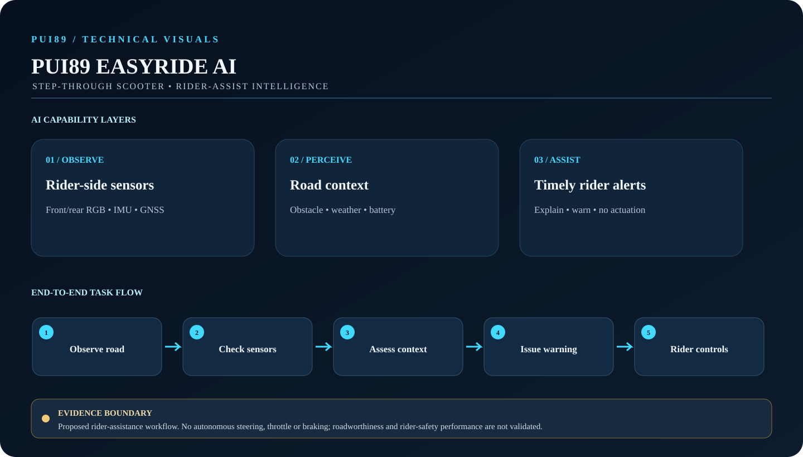

# PUI89 AI Step-Through Scooter — Inclusive Mobility Concept

## Product and AI system update — 18 November 2026

**Public product summary (EN):** PUI89 AI Step-Through Scooter is a practical two-wheel step-through mobility concept with rider-first AI awareness. The easy-mount floorboard and human-operated controls are central to the product direction.

**เทคโนโลยีและประโยชน์ (TH):** แนวคิดสกู๊ตเตอร์สองล้อแบบ Step-Through ขึ้นลงง่าย พร้อม AI ช่วยสังเกตยานพาหนะ คนเดินเท้า สิ่งกีดขวาง ป้ายจราจร สภาพถนน และบริบทความเสี่ยงน้ำท่วม ส่งคำเตือนที่กระชับและช่วยแสดงข้อมูลแบตเตอรี่/อุณหภูมิเมื่อมีข้อมูลจากช่องทางที่รองรับ

**AI technology direction:** computer vision; object detection and tracking; GNSS/IMU; edge AI; sensor fusion; weather and road context; read-only battery/vehicle telemetry; uncertainty-aware rider alerts and emergency-assistance information.

**Who it serves:** daily commuters, practical urban riders, delivery/service riders and people who value accessible step-through mobility with additional awareness support.

**Safety boundary:** the rider retains full control of steering, throttle and braking. No autonomous riding or physical actuation. Flood-risk alerts support avoidance and do not establish water-wading or waterproof capability. No functioning scooter, rider trial, road validation, collision-prevention result or certification is claimed.

**Project website:** [English](https://pui89.github.io/ai-robot-motorcycle.html) · [ภาษาไทย](https://pui89.github.io/ai-robot-motorcycle-th.html) · [PUI89 portfolio](https://pui89.github.io/)

---

## Product at a glance

**Product direction:** A human-centred two-wheel step-through mobility concept with rider-assistance AI.

**User value:** Explore practical, accessible everyday mobility with concise hazard awareness while the rider retains full control.

**Key capabilities and design priorities:** Road and obstacle awareness; weather and flood-risk context; collision and vehicle-health advisory concepts; emergency assistance and rider-focused alerts.

**Evidence maturity:** **Specified** — the rider-first step-through concept and engineering requirements are documented. No functioning scooter, rider trial, road validation or certification is established.

**Evidence reviewed:** 17 November 2026. See the [shared PUI89 development record](https://pui89.github.io/) for current evidence, limitations and the next milestone.

**Evidence boundary:** AI must not command steering, throttle or braking; roadworthiness and rider-safety performance are not validated.

**Project links:** [English website](https://pui89.github.io/ai-robot-motorcycle.html) · [ภาษาไทย](https://pui89.github.io/ai-robot-motorcycle-th.html) · [PUI89 portfolio](https://pui89.github.io/)  

---
## Open-source-first engineering

PUI89 prioritises open-source software, transparent licensing, reproducible workflows and evidence-led collaboration. Model weights, datasets, hosted services and hardware are assessed separately for provenance, licence terms, security, data handling, resource requirements and intended use. Public availability alone does not establish permission for reuse or commercial deployment.

> **PUI89 engineering standard:** [Simple, Safe and Professional](https://github.com/Pui89/Pui89.github.io/blob/main/docs/PUI89_SIMPLE_SAFE_PROFESSIONAL_STANDARD.md) — shared guidance for usability, safety, evidence, privacy and maintainable engineering.

## PUI89 — Intelligent Systems. Verifiable Decisions. Safer Outcomes.

PUI89 develops intelligent software and next-generation robotic systems for practical challenges across agriculture, emergency response, multimodal inspection, home environments and mobility. Our engineering approach integrates perception, contextual reasoning, decision intelligence, safety engineering and evidence-led validation.

### Engineering capabilities

- **Perception and sensing:** visual, spatial and multimodal information processing.
- **Context and reasoning:** world-state representation, uncertainty handling and evidence alignment.
- **Decision intelligence:** structured recommendations, action proposals and human approval boundaries.
- **Safety engineering:** risk-aware operating limits, safe-state logic and failure reporting.
- **Verification and assurance:** reproducible tests, benchmark records, provenance and traceable engineering evidence.

### Technology governance

PUI89 selects and integrates technologies according to capability, provenance, security, licence obligations, maintainability, interoperability and operational suitability. Product claims are grounded in documented implementation and validation rather than a list of underlying components. Required third-party notices and attributions remain in the appropriate technical and legal records.

**Development principle:** distinguish implemented capabilities, tested software behaviour, simulation results, proposed designs and independently validated real-world performance. A concept or passing software test is not represented as a commercially validated physical product.

> **PUI89 | Intelligent Systems. Verifiable Decisions. Safer Outcomes.**
> 
> **Project:** PUI89 AI Step-Through Scooter  
> **Focus:** Human-centred AI step-through scooter and inclusive mobility research concept  
> **Development stage:** Early concept and engineering foundation; no functioning motorcycle, rider trial or road certification is established.
> 
> **Project website:** [English](https://pui89.github.io/ai-robot-motorcycle.html) · [ภาษาไทย](https://pui89.github.io/ai-robot-motorcycle-th.html) · [PUI89 portfolio](https://pui89.github.io/)
> 
> **Validation boundary:** AI assistance remains advisory; no autonomous riding, physical actuation, roadworthiness or rider-safety validation is claimed.

## Hardware & Materials Sourcing

PUI89 uses a traceable sourcing workflow for materials, mechanical parts, sensors, compute, power and control components. See the [bilingual Hardware & Materials Sourcing guide](https://pui89.github.io/materials.html) for the process covering exact manufacturer/model identification, Thailand and international supplier discovery, country-of-origin evidence, dated pricing and availability, lead times, shipping, compatibility checks and verification gates. Product-specific candidates are added only when supported by evidence; research candidates are not purchases or validated hardware.

### Prototype materials & cost snapshot

**Planning allowance for one research prototype: ฿11,000–50,000.** This is a preliminary estimate from the [PUI89 project-specific BOM](https://pui89.github.io/materials.html#project-boms), not a supplier quotation or verified current market price.

Rider-centred awareness research for a practical step-through two-wheeler, using removable sensors and read-only telemetry.

| Main item | Prototype quantity | Purpose |
|---|---:|---|
| Forward RGB camera | 1 | Road/obstacle observation |
| Rear RGB camera | 1 | Rear observation |
| GNSS receiver + IMU | 1 each | Position and motion context |
| Read-only telemetry/battery interface | 1 | Monitor supported data only |
| Edge compute | 1 shared | Reuse shared unit first |
| Weatherproof mounts, isolation and cables | 1 set | Rain and vibration protection |

**Special engineering / purchase gate:** Keep all rider controls human-operated. Do not command steering, throttle or braking. Validate vibration, rain protection, camera field of view, mounting retention, power isolation and rider distraction before closed-course tests.

**Shared engineering bench (tracked separately):** approximately ฿16,500–46,000 if the existing development computer is reused. This is a portfolio-level allowance for reusable compute, one RGB-D camera, bench power supply/multimeter, two microcontroller boards and reusable tools/wiring/adapters; it is not added to each project total. Allocate each shared item once, not once per product.

**Cost status:** exact manufacturer/model, manufacturing origin, supplier, stock, lead time and dated prices remain to be verified. Freight, insurance, duty, VAT, brokerage, local delivery, custom fabrication labour and certification are not priced here; calculate Thai landed cost only from dated quotations. Quantities are for one prototype; no purchase or supplier commitment is authorised. Software-first work can continue with available computing and appropriately licensed open-source tools before hardware procurement.

## Perception & Task Intelligence (PTI)

**Role in this product:** provide rider-centred road awareness and concise warning support for the PUI89 AI Step-Through Scooter concept. PTI is the shared PUI89 perception-and-task framework; these are intended research tasks, not production rider-safety features.

**Priority perception tasks**
- Check camera visibility, image quality, weather effects, sensor availability and observation freshness.
- Detect supported nearby vehicles, pedestrians, road hazards and traffic signs.
- Track approaching or crossing road users where sensor placement and evaluation support reliable association.
- Estimate relative distance or closing risk only with suitable calibrated inputs; otherwise report uncertainty rather than a precise risk score.
- Interpret rain and visibility context, and surface authorised read-only battery/temperature observations if those interfaces become available.
- Present concise, low-distraction rider warnings with evidence and uncertainty; abstain when inputs are missing or unreliable.

**Task flow:** OBSERVE → PERCEIVE → ASSESS → DECIDE → RESPOND → LEARN FROM EVIDENCE. Outputs are advisory only. The rider remains in control; PTI must not command steering, throttle or braking.

**First evidence gate:** licensed road-scene datasets, defined supported classes, held-out evaluation, missed/false detection analysis, uncertainty and latency tests, followed by staged stationary/closed-course evaluation under human supervision and independent safety controls.

**Not established:** collision prevention, production-ready rider safety, autonomous control, validated flood operation or physical road performance. See the [shared PTI specification](https://github.com/Pui89/PUI89-Shared-AI-Core/blob/main/docs/perception/PUI89_PERCEPTION_TASK_INTELLIGENCE_V1.0.md) (maintainer repository access required).

## Six Core Intelligence Groups — Product Allocation

PUI89 uses six shared intelligence groups across its six active products. This product allocation is a target architecture and capability map; it does not claim that every model, sensor, integration or physical function is implemented or validated.

- Vision Intelligence — image/video understanding, detection, classification, segmentation, tracking, depth and spatial cues.
- Audio Intelligence — speech recognition, sound/event perception, speaker diarisation where justified, audio-visual association, acoustic diagnostics and speech response.
- Multimodal Intelligence — context-aware fusion of vision, audio, text, video and authorised sensor/time-series data with provenance and uncertainty.
- Robotics Intelligence — robot/environment understanding, localisation, navigation, motion planning and manipulation where the product has suitable hardware.
- Action & Reaction Intelligence — task planning, bounded proposals, event response, prediction, recovery and escalation.
- Safety & Control Intelligence — independent permissions, operating limits, verification, human approval, fault handling, safe hold and emergency-stop boundaries.

### PUI89 AI Step-Through Scooter capability allocation

- **Vision:** Road surface, potholes, traffic, pedestrians, obstacles and rider-state cues.
- **Audio:** Rider voice interaction, horn/siren recognition and mechanical sound diagnostics.
- **Multimodal:** Camera/IMU/GNSS/weather/audio/battery/temperature context fusion.
- **Robotics:** Rider-facing route, parking-memory and hazard advisory planning.
- **Action & Reaction:** Pothole, collision-risk, emergency-request and vehicle-anomaly alerts.
- **Safety & Control:** Human rider retains steering/throttle/braking; low-distraction warnings and safe failure.

**Integration rule:** each product uses only the modules justified by its mission, data rights, hardware, compute budget and validation evidence. Model outputs remain observations or bounded proposals. Safety policy is product-specific and independent of model confidence. Unknown, stale, conflicting or out-of-scope inputs must be surfaced rather than guessed.

**Evidence status:** proposed capability allocation unless a separate implementation record, reproducible test or domain-specific validation explicitly says otherwise. Audio models, speaker diarisation, sound classifiers, VLM/VLA policies and robotics stacks require separate provenance, licence, compute, privacy and suitability review before adoption. No automatic model download or installation is authorised.

### Six-intelligence concept visual

*Concept diagram only: it illustrates intended software intelligence domains, not a built product, installed model stack, integrated sensor suite or validated capability.*

## Development stage

**Current stage:** Concept & engineering foundation  
**ขั้นการพัฒนา:** แนวคิดและพื้นฐานวิศวกรรม

**Evidence:** Rider-centred requirements and early engineering/software research are documented.

**Limitations:** No functioning motorcycle, rider trials, road certification or validated rider-safety performance is established.

**Next milestone:** Complete a safety-led vehicle requirements and hazard-analysis baseline before any physical design or build.

## Project website QR codes

<table><tr><td align="center"><strong>English website</strong>  <a href="https://pui89.github.io/ai-robot-motorcycle.html">Open English website</a></td><td align="center"><strong>เว็บไซต์ภาษาไทย</strong>  <a href="https://pui89.github.io/ai-robot-motorcycle-th.html">เปิดเว็บไซต์ภาษาไทย</a></td></tr></table>

## PUI89 development maturity snapshot — 12 November 2026

**Strategic direction: From AI Projects to AI Products.**  
**Current maturity: Level 2 — Architecture Defined.** The product architecture and software-first research foundation are documented; a built motorcycle and validated physical capabilities are not established.

**Shared platform evidence (separate from project validation):** the PUI89 Shared AI Core main-branch CI reported 187 dependency-free tests passed on 11 November 2026. This platform-level result does not establish this project's model accuracy, physical integration or field performance.

| Area | Verified position |
|---|---|
| Product definition | Rider-first two-wheel concept with easy step-through access, upright posture, supportive seating and practical everyday usability. |
| Inclusive requirements | Low/open step-through, broad non-slip footboard, snag-risk reduction, readable controls and diverse adult-rider fit are design requirements requiring user testing. |
| Software and AI | Software-first and simulation-first research scaffold; opt-in model-adapter code is documented, but model inference and motorcycle-specific accuracy are not yet tested. |
| Physical product | No built motorcycle, validated braking/stability, load capacity, battery layout, weather protection or road certification is established. |

**Next product gate:** translate rider needs into measurable ergonomic and safety requirements; assess entry/exit, clothing snag hazards, centre of gravity, structural loads, braking, stability, battery/thermal protection, serviceability and regulatory constraints. Create deterministic software/simulation scenarios before considering physical integration.

**Product discipline:** the rider retains control; no autonomous riding or physical actuation is enabled. Water resistance, fire performance, durability and road safety are requirements for qualified engineering and testing, not existing capabilities. No paid API, cloud GPU, automatic model download or physical vehicle actuation is part of this update.

**Updated concept direction:** premium two-wheel step-through scooter with an upright rider position, long supportive seat, continuous non-slip floorboard, enclosed bodywork and rider-facing AI alerts. Flood-depth awareness is an advisory research feature only; **20 cm is a future engineering test target, not an approved or safe water-crossing capability.**

**Design direction:** friendly, simple, softly rounded and approachable — with a low step-through frame, upright posture, supportive seat and easy-to-understand controls.

**Project type:** AI-enabled motorcycle research concept; software-first and simulation-first.  
**Status:** Early-stage concept and engineering foundation — not a built, tested, or road-certified vehicle.

## Mission

Develop a welcoming motorcycle concept that is easier to mount, comfortable to sit on and manageable at low speed for a broad range of adult riders. AI assistance is limited to hazard awareness, road-condition context, vehicle-health monitoring and clear advisory support. The rider remains responsible for vehicle control. No autonomous riding or physical actuation is enabled.

## PUI89 AI Step-Through Scooter V3 visual design

- **Seat:** black, long touring-style bench with supportive contour; final passenger ergonomics require user trials.
- **Floor:** one continuous, broad, flat, non-slip platform through the central step-through area, with no middle cut-out or open gap. Structural integration and foot clearance require engineering validation.
- The updated V3 concept replaces the earlier open-centre illustration and is used on both language versions of the project page and both PUI89 homepages.

## PUI89 AI Step-Through Scooter visual design

- Rounded, friendly body panels with a compact, clean silhouette.
- Low, open step-through space and a broad, non-slip floorboard designed to make mounting in skirts or dresses easier.
- Smooth leg-area panels and a fully enclosed chain/belt design target to reduce clothing snag points; actual clothing clearance and safety require user testing.
- Upright riding posture, supportive seat and relaxed handlebar reach.
- Clear headlamp and simple high-contrast display.
- Low-centre battery packaging as a design study, not a verified layout.
- Calm Deep Navy, pearl white, soft cyan and mint accent palette.

See the [inclusive design brief](docs/EASYRIDE_INCLUSIVE_DESIGN.md) and [concept SVG](docs/CONNECTED_FLOOR_BLACK_SEAT_V3.svg).

## PUI89 engineering rules

- **Local-first:** external services and datasets require prior technical, licensing and security review.
- **Simulation first:** no commands to physical vehicles, motors, brakes, steering or batteries.
- **Safety before features:** fail-safe behavior, human override, uncertainty reporting and hazard analysis are mandatory.
- **Evidence before claims:** distinguish implemented, simulated, proposed and independently validated capabilities.
- **Shared AI Core:** reuse PUI89 contracts and safety/evidence components; avoid duplicate core systems.
- **Security by default:** least privilege, dependency and secret checks, protected branches and review before release.
- **No unsupported performance or road-safety claims.**

## Inclusive rider-first requirements

- Make mounting and dismounting easier with a low, wide step-through opening, including for riders wearing skirts or dresses.
- Provide a broad, flat, non-slip footboard, smooth snag-resistant side covers and an enclosed chain/belt layout; test hem clearance and safe foot placement.
- Do not claim all clothing is safe: loose or long fabric can still catch in wheels or moving parts, so protective riding gear and clothing guidance remain important.
- Provide upright posture, supportive seating, relaxed reach and adjustable contact points.
- Evaluate low-centre-of-gravity packaging without sacrificing strength or braking capability.
- Design readable displays, tactile controls, clear lighting and adjustable advisory alerts.
- Validate fit with diverse adult riders; never claim one size fits everyone.
- Treat ABS, traction control, hill-hold, walk-assist and reverse-assist as proposed features requiring qualified engineering and validation.

## Initial AI capability areas

1. Rider-assistance concept: hazard detection and clear warnings.
2. Vehicle health: monitored-state model for battery, electrical, thermal and component anomalies.
3. Environmental awareness: road surface, weather, visibility and nearby-object observations where lawful datasets or simulation are available.
4. Safety supervisor: confidence thresholds, stale-data detection, conflict handling, safe degradation and human override.
5. Evidence and evaluation: scenario-based tests, false-positive/false-negative tracking, latency measurement and reproducible reports.

## Agentic AI, VLM and VLA research direction

The roadmap explores three complementary areas for rider-first assistance. These are **planned research directions**, not claims that the models or capabilities are already implemented.

### 1. Agentic AI — bounded rider-support agents
- Explore agents for organizing observations, checking data freshness, summarizing road/weather context, tracking vehicle-health evidence and preparing understandable rider advisories.
- Require explicit task boundaries, provenance, confidence, uncertainty reporting and human approval for consequential outputs.
- Keep deterministic safety gates independent of agent reasoning. Agents cannot control the motorcycle or override the rider.

### 2. Vision-Language Models (VLMs) — visual scene understanding
- Research image-and-text understanding for road-surface conditions, obstacles, signs, visibility, nearby objects and vehicle inspection observations.
- Evaluate lighting, rain, occlusion, camera placement, motion blur, domain shift, false alarms and missed hazards using licensed datasets or synthetic scenarios.
- Treat every output as an uncertain observation with source and timestamp; use clear advisory wording and preserve rider attention.

### 3. Vision-Language-Action (VLA) — mock action proposals only
- Study VLA methods in simulation to translate visual/language context into structured **non-executing** proposals, such as “increase following-distance awareness” or “ask the rider to inspect a warning”.
- Store proposals as typed **ActionProposal** records with preconditions, confidence, expected effects, risk and evidence references.
- Do not generate or execute steering, throttle, braking, acceleration, gear, motor, battery or other physical-control commands. The rider remains in control at all times.
- Any future hardware study requires a separate safety case, qualified engineering, regulatory review and validated rider testing.

**Research sequence:** shared AI Core contracts → deterministic rider-advisory baseline → synthetic/simulation scenarios → VLM evaluation → bounded agent orchestration → mock VLA proposals → robustness, usability and safety evaluation. No new model weights, packages, paid APIs, subscriptions or cloud compute are required or authorized by this roadmap.

## Development stages

1. Define requirements, hazards, operating boundaries and shared AI Core interfaces.
2. Build software-only data contracts and deterministic baseline logic.
3. Create synthetic/simulation scenarios; do not connect to a real motorcycle.
4. Add evaluation, robustness, security and regression tests.
5. Consider hardware only after documented safety reviews, legal review and qualified engineering validation.

## Weight and validation boundary

An early feasibility study may explore a 95–110 kg vehicle-mass target, excluding optional accessories. This is an unvalidated research target, not a final specification. Rider fit, structural strength, braking, stability, load capacity and regulatory requirements take priority over weight reduction.

Water resistance, fire resistance, battery safety, braking performance and durability are requirements to investigate and test — they are not verified capabilities.

## Current truth

This repository is an initial software and research scaffold. It does not contain a functioning motorcycle, validated perception model, real-time vehicle integration or certified safety system. All outputs are advisory prototypes until independently validated.

## Repository map

- `docs/PROJECT_PLAN.md` — scope, architecture and staged roadmap.
- `docs/EASYRIDE_INCLUSIVE_DESIGN.md` — rider ergonomics, inclusive design, durability and validation requirements.
- `docs/PUI89_AI_STEP_THROUGH_SCOOTER_CONCEPT.svg` — premium Deep Navy + Electric Cyan AI step-through scooter concept illustration; not production CAD.
- `docs/SAFETY_CASE.md` — hazards, safeguards and validation boundaries.
- `SECURITY.md` — vulnerability reporting and security policy.
- `tests/` — software-only tests.
- `.github/workflows/quality.yml` — dependency-light automated checks.

## PUI89 portfolio links

- **English project page:** [PUI89 AI Step-Through Scooter](https://pui89.github.io/ai-robot-motorcycle.html)
- **Thai project page:** [PUI89 AI Step-Through Scooter — ภาษาไทย](https://pui89.github.io/ai-robot-motorcycle-th.html)
- **PUI89 main portfolio:** [https://pui89.github.io/](https://pui89.github.io/)
- **Website source repository:** [Pui89/Pui89.github.io](https://github.com/Pui89/Pui89.github.io)
- **Car companion project:** [PUI89 AI Robot Car](https://github.com/Pui89/AI-Autonomous-Robot-Car)

## License

See the repository's [LICENSE](LICENSE) file for the applicable permissions and conditions.

## Hugging Face vision models — opt-in local integration

This repository now includes real Hugging Face checkpoint adapters in [`pui89_models/hf_vision.py`](pui89_models/hf_vision.py), with project-specific usage boundaries in [`docs/HUGGING_FACE_MODEL_INTEGRATION.md`](docs/HUGGING_FACE_MODEL_INTEGRATION.md).

- **OWLv2:** `google/owlv2-base-patch16-ensemble` for text-conditioned object proposals.
- **Intel DPT-Hybrid:** `Intel/dpt-hybrid-midas` for relative scene depth where appropriate; not calibrated distance or physical depth.
- **local-first default:** no packages or model weights are installed/downloaded automatically; CPU-only inference, local cache only by default, no hosted inference API or cloud GPU.
- **Evidence status:** adapter code is added; model inference and project-specific accuracy are NOT YET TESTED. Outputs remain uncertain observations for human review, never actuator commands.

## PUI89 efficient engineering profile

This project follows the adopted [PUI89 World-Class Engineering Standard v1.0](https://github.com/Pui89/Pui89.github.io/blob/main/docs/PUI89_WORLD_CLASS_ENGINEERING_STANDARD_V1.0.md) as its portfolio-wide engineering framework.

**Project focus:** Prioritise low-power monitoring, advisory latency, resource-bounded perception, battery/thermal health and fail-safe degradation. Do not optimise by weakening rider alerts, deterministic safety gates or human control.

Track relevant RAM, CPU/GPU, latency, storage and network measurements using documented workloads and comparable environments. Record power (W/Wh), battery runtime and temperature only when suitable physical instruments and hardware are available. External services, datasets and model downloads require explicit review before adoption. Efficiency changes must preserve accuracy, safety, evidence integrity, privacy and security. Unmeasured physical performance must be labelled **not measured**.

---

## Security, malware and supply-chain protection

Security policy: [SECURITY.md](SECURITY.md). Report suspected vulnerabilities privately; do not publish exploit details, rider data or secrets in public issues.

Project-specific controls and review requirements:
- Treat simulated road scenes, maps, telemetry, sensor inputs, model outputs and imported files as untrusted.
- Validate units, ranges, timestamps, source and stale/conflicting observations.
- Review dependencies, simulator assets, model files and GitHub Actions for provenance, licences and vulnerabilities before adoption.
- Never commit credentials, rider identities, precise location histories or private records.
- This repository has no physical motorcycle or actuator authority; AI output is advisory only and must never control steering, throttle, braking or vehicle systems.
- Keep CI least-privilege and do not expose secrets to untrusted pull-request code.

A scan or passing test is evidence only for the checks actually run; it does not establish whether the repository contains malware or vulnerabilities.

## PUI89 seven-dimension quality recommendations

**Last reviewed: 8 November 2026 · Review month: November 2026**

This project uses the shared PUI89 quality framework. The indicators are guidance/status labels, not scores, certification or proof that work is complete.

| Dimension | Recommendation for this project | Indicator |
|---|---|---|
| Brand identity | Maintain the PUI89 Deep Navy + Electric Cyan system, consistent project naming and the approved project accent. | 🔵 Guidance |
| Website and accessibility | Keep English and Thai pages aligned, responsive, accessible, correctly linked and date-stamped. | 🔵 Guidance |
| AI software and applications | Version contracts, preserve provenance, propagate uncertainty, abstain on insufficient evidence and test safe human-review boundaries. | 🟢 Quality target |
| Physical products and robotics | Define measurable structural, power, thermal, water-ingress, fire-risk, maintenance and emergency-stop requirements; do not claim untested ratings. | 🟠 Evidence required |
| Documentation and research evidence | Maintain architecture, requirements, reproducible tests, data/model licences, limitations and traceable evidence links. | 🔵 Guidance |
| Product and commercial readiness | Validate the user problem, intended operator, value, support model, lawful IP/data position and release gates before commercial claims. | 🟠 Evidence required |
| Professional environment and presentation | Use consistent technical diagrams, demonstrations and partner-facing materials; do not imply facilities or partnerships without evidence. | ⚪ Not assessed |

**Project-specific priority:** Preserve the two-wheel, human-rider-first and step-through accessibility concept. Prioritise low-speed stability, frame fatigue, braking, suspension, rider ergonomics, load limits, battery safety and manual control; do not imply self-balancing or road approval without tests.

**Status legend:** 🔵 framework guidance added · 🟢 engineering quality target · 🟠 evidence or validation still required · ⚪ not assessed. These labels describe the review state of recommendations, not overall project maturity. Project maturity changes only when supported by verified repository evidence, reproducible tests or controlled validation.

<!-- PUI89_PROJECT_STRENGTH_SCORECARD:START -->
## PUI89 Project Strength Scorecard | เกณฑ์ประเมินความแข็งแกร่งของโครงการ

**Current review status: Not yet scored · Completed evidence-backed strength reviews: 0.** This is a recordkeeping status, not a claim that no development or testing exists.

**สถานะการประเมิน: ยังไม่มีคะแนน · รายงานประเมินที่เสร็จสมบูรณ์และมีหลักฐาน: 0 รายการ** ตัวเลขนี้หมายถึงจำนวนรายงานที่บันทึกครบตามเกณฑ์ ไม่ได้หมายความว่าไม่มีการพัฒนาหรือทดสอบ

### Four Project Indicators | ตัวชี้วัดโครงการ 4 ด้าน

| Indicator / ตัวชี้วัด | What it measures / สิ่งที่ประเมิน | Current status / สถานะ |
|---|---|---|
| Engineering Strength / ความแข็งแกร่งทางวิศวกรรม | Verified technical capability and system integration / ความสามารถทางเทคนิคและการเชื่อมต่อระบบที่ตรวจสอบได้ | Not yet assessed / ยังไม่ได้ประเมิน |
| Evidence Confidence / ความเชื่อมั่นของหลักฐาน | Evidence traceability, reproducibility and validation quality / การตรวจสอบย้อนกลับ การทำซ้ำ และคุณภาพการตรวจสอบ | Not yet assessed / ยังไม่ได้ประเมิน |
| Implementation Level / ระดับการพัฒนาที่ดำเนินการแล้ว | Work actually implemented, separated from proposed work / งานที่พัฒนาแล้วจริง แยกจากงานที่เป็นข้อเสนอ | Not yet assessed / ยังไม่ได้ประเมิน |
| Project Maturity / ความสมบูรณ์ของโครงการ | Evidence-based development stage, from concept to operational demonstration / ระยะการพัฒนาที่อ้างอิงหลักฐาน ตั้งแต่แนวคิดถึงการสาธิตการใช้งานจริง | Formal stage assessment pending / รอการประเมินระดับอย่างเป็นทางการ |

These four indicators are separate from the weighted 100-point score below. No score, percentage or maturity stage is assigned until a dated evidence-backed review is completed.

ตัวชี้วัดทั้ง 4 ด้านนี้แยกจากคะแนนถ่วงน้ำหนัก 100 คะแนนด้านล่าง จะไม่กำหนดคะแนน เปอร์เซ็นต์ หรือระดับความสมบูรณ์จนกว่าจะมีรายงานประเมินที่ลงวันที่และมีหลักฐานครบถ้วน

| Dimension / ด้านประเมิน | Weight / น้ำหนัก |
|---|---:|
| Technical capability / ความสามารถทางเทคนิค | 25 |
| Testing and evidence / การทดสอบและหลักฐาน | 25 |
| Safety and reliability / ความปลอดภัยและความน่าเชื่อถือ | 20 |
| Engineering maturity / วุฒิภาวะทางวิศวกรรม | 15 |
| Documentation and reproducibility / เอกสารและการทำซ้ำผล | 10 |
| Real-world validation / การตรวจสอบในโลกจริง | 5 |
| **Total / รวม** | **100** |

Scores are awarded only through a dated review with a defined scope, version/commit, evidence links, findings, limitations and next actions. Concepts, planned features, concept images, unrun tests and tool inventories do not earn implementation or test credit. Simulation results do not prove physical-world performance.

จะให้คะแนนเมื่อมีรายงานที่ระบุวันที่ ขอบเขต เวอร์ชัน/commit ลิงก์หลักฐาน ข้อค้นพบ ข้อจำกัด และขั้นตอนถัดไปเท่านั้น แนวคิด ฟีเจอร์ที่วางแผน ภาพแนวคิด การทดสอบที่ยังไม่ได้รัน และรายการเครื่องมือ จะไม่ได้คะแนนว่าเป็นการพัฒนาหรือการทดสอบที่เสร็จแล้ว ผลจำลองไม่ใช่หลักฐานยืนยันประสิทธิภาพในโลกจริง

**Scoring method / รายละเอียดเกณฑ์:** [English](https://github.com/Pui89/Pui89.github.io/blob/main/docs/PROJECT_STRENGTH_SCORECARD.md) · [ภาษาไทย](https://github.com/Pui89/Pui89.github.io/blob/main/docs/PROJECT_STRENGTH_SCORECARD_TH.md)

This project-strength review is separate from the documented development stage; it is not certification, safety approval or an investment rating.
<!-- PUI89_PROJECT_STRENGTH_SCORECARD:END -->

## Materials & Hardware — Research Plan

**Status: rider-assistance software concept and motorcycle hardware research.** No built, road-approved or validated AI motorcycle is claimed. The rider remains in control at all times.

| Subsystem | Candidate materials / hardware | Purpose and checks before selection |
|---|---|---|
| Base vehicle/frame | Existing two-wheel step-through motorcycle platform; engineered steel or aluminium components | Verify frame integrity, load rating, geometry, fatigue, legal type approval and qualified engineering |
| Body/step-through | Impact-resistant polymer panels, aluminium brackets, non-slip footboard and corrosion-resistant fasteners | Verify strength, snag points, heat, ground clearance and ingress |
| Seat/rider interface | Motorcycle-grade seat foam/cover and adjustable handlebar/contact-point hardware | Verify ergonomics, reach, passenger loading, durability and rider trials |
| Powertrain monitoring | Battery voltage/current/temperature sensing and compatible non-invasive diagnostic interfaces | Verify electrical compatibility, isolation, accuracy and no interference with OEM safety systems |
| Road perception | Forward/rear RGB cameras, optional radar/depth sensor and protected mounts | Verify weather, vibration, field of view, calibration, distraction and privacy |
| Weather context | Ambient temperature, rain/wetness and visibility-related observations | Verify sensor limits, false alarms and safe advisory wording |
| Motion/location | IMU, GNSS and lawful/compatible vehicle-speed input | Verify calibration, drift, interface safety and stale-data handling |
| Rider interface | Glance-limited display, audible/haptic alerts and acknowledgement controls | Verify distraction, accessibility, fail-silent behaviour and rider override |
| Power/enclosure | Fused low-voltage supply, protected DC-DC converter, sealed connectors and vibration-resistant enclosure | Verify transients, heat, water ingress, vibration, EMC and isolation |
| Safety/maintenance | Independent fuse/isolation, cable protection, service labels and manual disconnect | Verify qualified installation and no interference with braking/steering/throttle |

Investigate the two-wheel low step-through layout, continuous non-slip footboard, enclosed chain/belt, storage and comfortable two-person seating as engineering requirements—not confirmed specifications. Payload must include occupants and cargo and be validated against the base vehicle, tyres, suspension, frame and brakes.

AI may provide advisory hazard and vehicle-health warnings with confidence, provenance and data-freshness indicators. It must not command steering, throttle, braking, acceleration or other vehicle actuation. Water, dust, heat, vibration and fire resistance are requirements to test, not ratings to claim without evidence.

**Procurement rule:** research only. No purchases, subscriptions, supplier contact or paid services without explicit approval. Verify compatibility, datasheets, installation method, electrical limits, legal requirements, price, shipping and warranty before selection.

## Spatial Intelligence integration

See [the project-specific spatial integration profile](docs/spatial-intelligence/README.md). This is a documented integration contract; runtime sensor integration and physical validation remain pending.

<!-- PUI89_EVIDENCE_BACKED_REVIEW:START -->
## Evidence-backed project review status

**Project:** PUI89 AI Step-Through Scooter  
**README snapshot (13 November 2026): 0 completed evidence-backed reviews.** This snapshot is not auto-synchronised; the live [PUI89 portfolio review register](https://pui89.github.io/#evidence-backed-project-reviews) is the source of truth.

This is a review-record count, not a statement that development or testing has not occurred. Engineering work, CI runs, test results and simulation evidence may support a review, but do not automatically count as a completed review.

A review is counted only when its record includes all required fields: **completed status, review date, defined scope, reviewer role, outcome, and at least one supporting evidence reference**. Drafts, ratings, stars, page views and comments are excluded.

The portfolio-wide count is published on the [PUI89 website](https://pui89.github.io/#evidence-backed-project-reviews). Refresh this README snapshot when the shared register changes.

**สถานะการทบทวนโครงการที่มีหลักฐาน**  
**จำนวนการทบทวนที่เสร็จสมบูรณ์: 0** — ยังไม่มีบันทึกการทบทวนที่ผ่านเกณฑ์สำหรับโครงการนี้ในทะเบียนกลาง PUI89

ตัวเลขนี้เป็นจำนวนบันทึกการทบทวน ไม่ได้หมายความว่าไม่มีการพัฒนาหรือทดสอบ งานวิศวกรรม ผล CI การทดสอบ และหลักฐานจากการจำลองอาจใช้ประกอบการทบทวน แต่ไม่นับเป็นการทบทวนที่เสร็จสมบูรณ์โดยอัตโนมัติ

จะนับเมื่อมีสถานะเสร็จสมบูรณ์ วันที่ ขอบเขต บทบาทผู้ทบทวน ผลการทบทวน และหลักฐานอ้างอิงอย่างน้อยหนึ่งรายการครบถ้วนเท่านั้น รายการร่าง คะแนน ดาว ยอดเข้าชม และความคิดเห็นจะไม่นับ
<!-- PUI89_EVIDENCE_BACKED_REVIEW:END -->

---

## Preliminary Prototype Cost Estimate (15 November 2026)

**Indicative one-unit engineering prototype planning range: ฿60,000–฿200,000 (THB).**

**Included at a planning level:** AI compute and sensor-integration prototype using an existing compatible scooter or bench rig, camera/sensors, mounting, power integration and basic testing.

**Estimate status:** preliminary internal planning estimate only; not a supplier quotation, purchase commitment, verified bill of materials, fixed project budget or claim that a prototype exists. The range depends on final requirements, component selection, non-Chinese-origin supplier availability, compatibility, import/shipping costs and test scope. Obtain current written quotations and verify country of manufacture/origin, exact model/part number, specifications, warranty and lead time before any procurement.

**Generally excluded:** purchase of a donor scooter, engineering labour, research salaries, facilities, taxes/VAT, import duties, shipping unless stated in a supplier quotation, certification/regulatory approvals, production tooling, mass production, long-term maintenance and contingency. Major vehicle modifications and road-vehicle certification are also excluded.

**Lower-cost development path:** continue software-first development, open-source tools and simulation before purchasing physical hardware. Shared AI Core software and reusable development equipment may reduce duplicated costs; savings are not yet quantified. No purchase or installation is authorised by this estimate.

### Prototype hardware, materials and component budget breakdown

**Planning scope:** one engineering prototype; total planning range remains **฿60,000–฿200,000 THB**. The following subsystem allowances are preliminary engineering estimates, not supplier quotes. Individual ranges are not a promise of purchase price and must be reconciled against exact selected parts and written quotations before procurement.

| Subsystem / component type | Qty per prototype | Material / specification and function | Indicative allowance (THB) |
|---|---:|---|---:|
| Front / rear RGB cameras | 2 | Road and rear awareness; weather-rated housings and suitable field of view | ฿10,000–฿32,000 |
| Edge compute + local storage | 1 set | CPU-first compact computer; thermal and vibration envelope assessed | ฿15,000–฿45,000 |
| GNSS + IMU | 1 set | Position, movement and lean-context sensing; mount and calibration | ฿5,000–฿18,000 |
| Read-only telemetry interface | 1 isolated interface | Only supported read-only vehicle/battery data; no actuator control | ฿2,000–฿8,000 |
| Protected power + wiring | 1 set | Fuse, DC/DC, transient protection, connectors and removable harness | ฿5,000–฿18,000 |
| Weather / vibration mounts + enclosure | 1 set | Removable non-structural mounts, seals, vibration isolation and cable strain relief | ฿8,000–฿28,000 |
| Display / alerts / connectivity | 1 set | Simple rider alerts and local connectivity without distracting interfaces | ฿5,000–฿16,000 |
| Installation, calibration + closed-area tests | 1 lot | Stationary installation checks, vibration/water ingress checks and supervised advisory tests | ฿10,000–฿35,000 |

**Material families:** aluminium alloy or stainless-steel structural members where suitable; engineering polymer covers; corrosion-resistant fasteners; rated cables/connectors; protective enclosures; and product-specific seals, guards or vibration isolation. Exact alloy/grade, IP rating, load rating and country of manufacture remain unselected until engineering calculations and supplier evidence are available.

**Shared hardware accounting:** Shared AI Core software is not a product BOM. Reusable development computers, cameras or bench instruments must be listed as shared assets and allocated once; do not duplicate their full purchase cost across all six active products. Product-specific mounts, wiring, protection and integration remain in each product allowance.

**Sourcing controls:** prefer non-Chinese-origin candidates only when the exact manufacturing origin is evidenced. Record legal manufacturer, brand, exact model/part number, manufacturing country, evidence URL/document, authorised supplier, dated price/currency, stock, MOQ, lead time, warranty and landed-cost assumptions. Brand headquarters or seller location is not proof of manufacturing origin. Unknown origin = **UNVERIFIED**.

**Prototype boundary:** the allowance is for a controlled engineering prototype, not a certified commercial product or production-ready system. It excludes labour, research salaries, facilities, VAT/tax, import duties, freight/insurance unless explicitly quoted, certification, production tooling, mass production, maintenance and contingency. No purchase, download, installation or supplier commitment is authorised by this documentation.

## Shared Interaction Intelligence — PUI89 AI Step-Through Scooter AI Step-Through Scooter

The proposed rider interaction profile is deliberately limited to simple, low-distraction communication:

- Spoken navigation prompts and concise safety/status alerts.
- Optional voice requests when stationary or in a verified low-risk state.
- Thai/English speech support only after real-world noise, helmet and road-condition evaluation.
- Push-to-talk or physical controls as alternatives to voice.

**Rider safety:** no complex dialogue while moving, no reliance on speech for emergency control, and no autonomous steering, throttle or braking. The rider retains full vehicle control.

**Recommended model candidates for PUI89 AI Step-Through Scooter AI Scooter (not approved or integrated):**

| Model/tool | Role in scooter interaction | Status |
|---|---|---|
| [openai/whisper-small](https://huggingface.co/openai/whisper-small) | Speech-to-text for limited requests, preferably while stationary; evaluate helmet and road noise | PENDING_REVIEW |
| [hexgrad/Kokoro-82M](https://huggingface.co/hexgrad/Kokoro-82M) | English spoken navigation/status prompts; Thai TTS is not established | PENDING_REVIEW |
| [Silero VAD](https://github.com/snakers4/silero-vad) | Speech-segment detection for stationary push-to-talk use | PENDING_REVIEW |

Prioritise physical controls and minimal prompts; do not encourage dialogue while riding. These candidates cannot control steering, throttle or braking. Thai speech generation remains an open candidate-research task.

**Maturity:** proposed capability only. No voice model, microphone, speaker or road-tested interaction is claimed as integrated or validated.

## World-Class Engineering Standard v1.0

This product follows the [PUI89 World-Class Engineering Standard v1.0](https://github.com/Pui89/Pui89.github.io/blob/main/docs/PUI89_WORLD_CLASS_ENGINEERING_STANDARD_V1.0.md), alongside the [PUI89 Simple, Safe & Professional Engineering Standard](https://github.com/Pui89/Pui89.github.io/blob/main/docs/PUI89_SIMPLE_SAFE_PROFESSIONAL_STANDARD.md). The shared standard defines requirements traceability, Shared AI Core contracts, PTI evaluation, simulation, safety, hardware provenance, cost engineering, verification and release gates. Product capabilities remain subject to their stated evidence and validation boundaries; this reference does not imply that a gate has been passed.

## PUI89 Technical Visual — AI workflow

*Proposed rider-assistance workflow. No autonomous steering, throttle or braking; roadworthiness and rider-safety performance are not validated.*

This diagram follows the [PUI89 Technical Visual Standard v1.0](https://github.com/Pui89/PUI89-Shared-AI-Core/blob/main/docs/PUI89_TECHNICAL_VISUAL_STANDARD_V1.0.md). It explains the proposed product-specific AI workflow and does not imply unverified implementation or physical capability.

## Everyday Intelligence, Simple Operation & On-Device Alerts

**Design principle:** AI for Everyone. Easy to Use. Safe to Trust. Ready for the Real World.

PUI89 AI Step-Through Scooter follows the PUI89 shared design direction: make everyday life easier through intelligence, not make people learn complicated technology.

- **Simple physical operation:** clear buttons and a safe, bounded start workflow. Basic local use should not require an app, smartphone pairing or internet where technically feasible. Voice is optional.
- **Multi-Perception Intelligence (MPI):** select mission-appropriate vision, audio, touch/contact, spatial, motion, thermal and environmental sensing. Chemical sensing or material analysis is only for specific validated instruments; these are not universal human-equivalent senses.
- **On-device text alerts:** a readable physical display is a mandatory design requirement. Show plain-language Information, Warning and Emergency messages, what happened, uncertainty and the next safe step. Keep local alert history. Optional mobile notifications supplement, never replace, device alerts.
- **Accessibility:** large readable text, clear controls, high contrast, optional audio, plain language and adjustable preferences.
- **Safety and reliability:** preserve human authority, independent emergency/protective stops, safe hold, fault reporting, uncertainty/abstention and controlled recovery. No silent restart into hazardous action.
- **Offline-first essentials:** local functions and alerts should continue without internet where technically possible and supported by the final hardware.

- **Vehicle authority:** driver/rider remains in control. These requirements do not authorise autonomous steering, throttle or braking; alerts must be glanceable and non-distracting.

**Shared specification:** [PUI89 Everyday Intelligence & Multi-Perception Standard v1.0](https://github.com/Pui89/PUI89-Shared-AI-Core/blob/main/docs/interaction/PUI89_EVERYDAY_INTELLIGENCE_MPI_STANDARD_V1.0.md). These are design requirements, not claims that displays, sensors, offline operation, animal recognition or physical functions are already implemented or validated.

## Local Access, Controls & On-Device Information

**No single point of access. No mandatory smartphone. No remote-only operation.**

The product must remain usable for its essential intended functions if a remote is lost, a phone is unavailable, an app is not installed, or internet/cloud connectivity is lost. The primary interface must fit the product; it does not have to be a button on the robot.

- Provide a clear **primary local control** integrated into the product or vehicle, as appropriate.
- Provide an **independent fallback** that does not rely on the same remote, phone, app, wireless link or cloud service.
- Put essential status, instructions and warnings on a display or indicators physically associated with the product.
- Remotes and mobile apps are optional convenience/secondary interfaces, never the only way to operate, receive critical alerts or safely stop the system.
- If control or communication is lost, enter a defined safe state and provide a documented local recovery path. Never bypass safety interlocks.
- Show concise plain-language information: Ready/Not ready, current task, what was detected and confidence, warning and next action, power/health, human-confirmation requests, and completion/fault history.
- Use Thai/English where implemented, large readable text, clear symbols and optional audio. Do not rely on sound or colour alone.

**Product-specific interface direction**
- Primary: rider controls and built-in vehicle interface. Fallback: conventional rider-controlled safe stopping and vehicle procedures. Direct information: on-vehicle display/indicators and alerts.
- Example: “Battery low. Plan a safe stop and recharge.”

These are design requirements and message examples, not claims that the display, controls, sensors or detection capability are already installed or validated.

**Shared standard:** [PUI89 Everyday Intelligence & Multi-Perception Standard v1.0](https://github.com/Pui89/PUI89-Shared-AI-Core/blob/main/docs/interaction/PUI89_EVERYDAY_INTELLIGENCE_MPI_STANDARD_V1.0.md).

## No App Required — End-to-End User Experience

PUI89 products must be usable from setup through everyday operation, monitoring, configuration, safe stopping and recovery without requiring customers to download or install an application. Essential customer functions must be available directly through the product or its appropriate local operator station. No mandatory app, account, phone pairing or internet dependency for essential local operation where technically feasible. Remotes and mobile applications are optional convenience interfaces only, never the sole control, critical-alert or recovery path. This is a design requirement, not evidence of completed implementation or validation.

### ไม่ต้องใช้แอป — ประสบการณ์ใช้งานตั้งแต่ต้นจนจบ

ผลิตภัณฑ์ PUI89 ต้องใช้งานได้ตั้งแต่การตั้งค่าไปจนถึงการใช้งานประจำวัน การตรวจสอบ การปรับตั้งค่า การหยุดอย่างปลอดภัย และการกู้คืน โดยลูกค้าไม่ต้องดาวน์โหลดหรือติดตั้งแอป ฟังก์ชันที่จำเป็นต้องเข้าถึงได้โดยตรงผ่านตัวผลิตภัณฑ์หรือสถานีควบคุมในพื้นที่ ไม่บังคับใช้แอป บัญชีผู้ใช้ การจับคู่โทรศัพท์ หรืออินเทอร์เน็ตสำหรับการใช้งานพื้นฐานในพื้นที่เมื่อเป็นไปได้ทางเทคนิค รีโมตและแอปมือถือเป็นเพียงทางเลือกเสริม ไม่ใช่ช่องทางเดียวสำหรับควบคุม รับการแจ้งเตือนสำคัญ หรือกู้คืนระบบ ทั้งหมดนี้เป็นข้อกำหนดการออกแบบ ไม่ใช่หลักฐานว่าดำเนินการติดตั้งหรือทดสอบแล้ว.

## On-Device Warning & Alert Experience

**Design requirement:** essential warnings and system status must be shown directly on the product's integrated display or appropriate local operator station. No smartphone app, account, pairing, internet connection or remote service may be required for critical alerts, safe stopping or essential recovery.

**Severity:** use four levels — **Information, Advisory, Warning and Emergency**. Each alert should state what happened, affected area/subsystem, time and source, confidence/uncertainty, recommended safe action, and whether human acknowledgement is needed. Missing, stale or conflicting evidence must not be presented as confirmed or safe.

**scooter warning scope:** Road-surface and pothole hazards; nearby vehicle/person and collision-risk advisories; weather and verified flood-risk context; unknown water depth or passability; supported read-only battery, thermal and vehicle-health anomalies; sensor obstruction or stale data.

**Product safety boundary:** Alerts must be brief, glanceable and low-distraction; never encourage the rider to look at a screen while moving. If flood conditions are unknown, advise avoidance. The rider retains full steering, throttle and braking control.

**Local resilience:** keep active alerts and timestamped history locally, including acknowledgement and cleared state. Support Thai and English where the interface supports both. Essential alerts should continue during internet/cloud loss where technically feasible; optional mobile notifications only mirror local alerts. Report sensor obstruction, stale data, communication loss and internal faults. Define a safe response; never silently continue or automatically restart hazardous operation. Provide local acknowledge, inspect, pause/stop and documented recovery paths. Never advise bypassing an interlock or protective stop.

### ภาษาไทย — การแจ้งเตือนบนตัวผลิตภัณฑ์

ต้องแสดงคำเตือนและสถานะสำคัญผ่านหน้าจอที่ติดตั้งกับผลิตภัณฑ์หรือสถานีควบคุมในพื้นที่ที่เหมาะสม ห้ามบังคับให้ใช้แอป บัญชีผู้ใช้ การจับคู่โทรศัพท์ อินเทอร์เน็ต หรือบริการระยะไกล เพื่อรับคำเตือนสำคัญ หยุดระบบอย่างปลอดภัย หรือกู้คืนการใช้งานพื้นฐาน

กำหนดระดับความรุนแรง 4 ระดับ ได้แก่ **ข้อมูล (Information), คำแนะนำ (Advisory), คำเตือน (Warning) และฉุกเฉิน (Emergency)** แต่ละข้อความควรระบุเหตุการณ์ ระบบที่เกี่ยวข้อง เวลาและแหล่งข้อมูล ความเชื่อมั่น/ความไม่แน่นอน การดำเนินการที่ปลอดภัย และการยืนยันจากมนุษย์เมื่อจำเป็น ห้ามแสดงข้อมูลที่ขาดหาย ล้าสมัย หรือขัดแย้งกันว่าเป็นข้อเท็จจริงหรือปลอดภัย

**ขอบเขตคำเตือนเฉพาะผลิตภัณฑ์:** อันตรายจากพื้นผิวถนนและหลุมบ่อ รถหรือคนใกล้เคียงและความเสี่ยงการชน สภาพอากาศและบริบทน้ำท่วมที่ตรวจสอบได้ ความลึกของน้ำหรือความสามารถในการผ่านที่ยังไม่ทราบ ความผิดปกติของแบตเตอรี่ อุณหภูมิ และสุขภาพรถจากข้อมูลอ่านอย่างเดียว เซนเซอร์ถูกบังหรือข้อมูลล้าสมัย

**ขอบเขตความปลอดภัย:** คำเตือนต้องสั้น อ่านได้รวดเร็ว และไม่รบกวนสมาธิ ห้ามกระตุ้นให้ผู้ขับขี่มองหน้าจอขณะรถเคลื่อนที่ หากไม่ทราบสภาพน้ำให้แนะนำหลีกเลี่ยง ผู้ขับขี่ยังคงควบคุมพวงมาลัย คันเร่ง และเบรกทั้งหมด

เก็บคำเตือนที่ยังทำงานและประวัติเหตุการณ์พร้อมเวลาไว้ในระบบภายใน รองรับภาษาไทยและอังกฤษตามความสามารถของส่วนติดต่อ คำเตือนสำคัญควรทำงานได้เมื่ออินเทอร์เน็ตหรือคลาวด์ขัดข้องเท่าที่เทคโนโลยีรองรับ การแจ้งเตือนผ่านมือถือเป็นเพียงช่องทางเสริม ต้องรายงานเซนเซอร์ถูกบัง ข้อมูลล้าสมัย การสื่อสารขาดหาย และความขัดข้อง พร้อมกำหนดการตอบสนองที่ปลอดภัยและห้ามเริ่มการทำงานเสี่ยงต่อโดยอัตโนมัติ ผู้ใช้ต้องรับทราบ ตรวจสอบ หยุดหรือพักระบบ และกู้คืนจากส่วนควบคุมในพื้นที่ได้ ห้ามแนะนำให้ข้ามระบบป้องกัน

**Evidence status:** design requirement only; no display, alert hardware, offline behaviour or safety performance is claimed as implemented or validated. Conformance remains **Unknown / Not Tested** until traceable evidence exists.

## Incident Evidence, Image Recall & User-Requested Review

When an abnormal condition is detected, create a traceable incident record locally. Where a suitable camera or image sensor is actually available, save relevant captured image(s) on protected product storage. Never imply an image exists if none was captured; link original evidence to its incident.

Each record should include, where available: unique incident ID; local date/time and time zone; product/subsystem and location or zone; severity; event title and plain-language summary; full alert text and spoken message; source sensor; confidence/uncertainty and data-quality state; captured image(s); and acknowledgement, review and resolution history. Clearly mark missing images, unavailable sensors, uncertain timestamps and incomplete records.

**User-controlled history:** provide a local **READ / VIEW HISTORY** control on the product display or appropriate console. Browse year → month → day; open summaries; press to read full alerts; view saved images; replay spoken alerts where supported; and navigate earlier/later incidents. Show event date/time and incident ID beside every image. Vehicle users may review images only when safely parked.

**Local preservation:** history must be reviewable without a phone, app, cloud or internet. Warn when storage is nearing capacity. Never silently overwrite or automatically delete important incident evidence. Define a visible retention/capacity policy and user-controlled export/recovery before implementation. Protect records against accidental alteration and restrict access appropriately; do not claim tamper-proof storage unless verified.

**Product-specific evidence scope:** Road-surface/pothole observations, nearby-vehicle/person risk alerts, verified weather/flood context, unknown water passability, sensor/data-quality faults and supported read-only vehicle-health anomalies. Image review only while safely parked; never encourage viewing while riding.

**Evidence status:** design requirement only. Image capture, local storage, date-based search, voice replay, preservation, privacy controls and recovery remain **Unknown / Not Tested** until verified on the actual product.

### ภาษาไทย — หลักฐานเหตุการณ์และภาพย้อนหลัง

เมื่อระบบตรวจพบความผิดปกติ ให้สร้างบันทึกเหตุการณ์ไว้ภายในผลิตภัณฑ์ หากมีกล้องหรือเซนเซอร์ภาพที่เหมาะสมและใช้งานได้จริง ให้บันทึกภาพที่เกี่ยวข้องไว้ในพื้นที่จัดเก็บภายใน ห้ามกล่าวอ้างว่ามีภาพหลักฐานหากไม่มีการบันทึกจริง และต้องเชื่อมโยงภาพต้นฉบับกับเหตุการณ์นั้น

ข้อมูลควรมีเท่าที่ระบบบันทึกได้: รหัสเหตุการณ์; วันที่และเวลาพร้อมเขตเวลา; ผลิตภัณฑ์/ระบบย่อยและตำแหน่ง; ระดับความรุนแรง; หัวข้อและสรุปที่เข้าใจง่าย; ข้อความแจ้งเตือนฉบับเต็มและข้อความเสียง; เซนเซอร์ต้นทาง; ความไม่แน่นอนและคุณภาพข้อมูล; ภาพที่บันทึก; ประวัติการรับทราบ ตรวจสอบ และแก้ไข หากไม่มีภาพ เซนเซอร์ไม่พร้อม เวลาไม่แน่นอน หรือข้อมูลไม่ครบ ต้องแสดงให้ชัดเจน

**ผู้ใช้เรียกดูเองได้:** มีคำสั่ง **READ / VIEW HISTORY** บนหน้าจอผลิตภัณฑ์หรือคอนโซลในพื้นที่ เลือกดู ปี → เดือน → วัน เปิดสรุป กดอ่านข้อความฉบับเต็ม ดูภาพ เล่นเสียงแจ้งเตือนซ้ำเมื่อรองรับ และเลื่อนไปยังเหตุการณ์ก่อนหน้าหรือถัดไป ทุกภาพต้องแสดงวันที่ เวลา และรหัสเหตุการณ์ สำหรับรถยนต์และสกู๊ตเตอร์ให้ดูภาพเมื่อจอดอย่างปลอดภัยเท่านั้น

**การเก็บรักษาภายใน:** ต้องเรียกดูประวัติได้โดยไม่ใช้โทรศัพท์ แอป คลาวด์ หรืออินเทอร์เน็ต แจ้งเตือนเมื่อพื้นที่ใกล้เต็ม ห้ามเขียนทับหรือลบหลักฐานสำคัญโดยอัตโนมัติ ต้องกำหนดนโยบายพื้นที่/ระยะเวลาเก็บรักษาที่ผู้ใช้มองเห็นได้ และการส่งออก/กู้คืนที่ผู้ใช้ควบคุมได้ ป้องกันการแก้ไขโดยไม่ตั้งใจและจำกัดสิทธิ์อย่างเหมาะสม ห้ามกล่าวอ้างว่าป้องกันการแก้ไขได้สมบูรณ์หากยังไม่ผ่านการตรวจสอบ

**ขอบเขตหลักฐานเฉพาะผลิตภัณฑ์:** Road-surface/pothole observations, nearby-vehicle/person risk alerts, verified weather/flood context, unknown water passability, sensor/data-quality faults and supported read-only vehicle-health anomalies. Image review only while safely parked; never encourage viewing while riding.

**สถานะหลักฐาน:** ข้อกำหนดการออกแบบเท่านั้น การบันทึกภาพ การจัดเก็บ การค้นหาตามวัน/เดือน การเล่นเสียงย้อนหลัง การรักษาหลักฐาน ความเป็นส่วนตัว และการกู้คืนยังเป็น **Unknown / Not Tested** จนกว่าจะพัฒนาและทดสอบกับผลิตภัณฑ์จริง

## PUI89 Easy Direct Control Standard v1.0 — Proposed

This product follows the shared [PUI89 Easy Direct Control Standard](https://github.com/Pui89/Pui89.github.io/blob/main/docs/PUI89_EASY_DIRECT_CONTROL_STANDARD_V1.0.md). Essential operation and safety information must be available from the scooter itself, using simple handlebar controls and an integrated display; no smartphone or application is required.

**Proposed rider interface:** physical vehicle power/start controls as defined by the vehicle architecture; simple display-accessible AI modes such as Normal, Safety Monitoring and Navigation Assistance; direct status and warning display; and vehicle-standard emergency controls designed independently of the AI layer.

**Operating boundary:** the rider retains full control. PUI89 AI must not command steering, throttle or braking. Warnings must be concise and low-distraction. Remote/application functions are optional and cannot replace on-vehicle warnings or controls.
