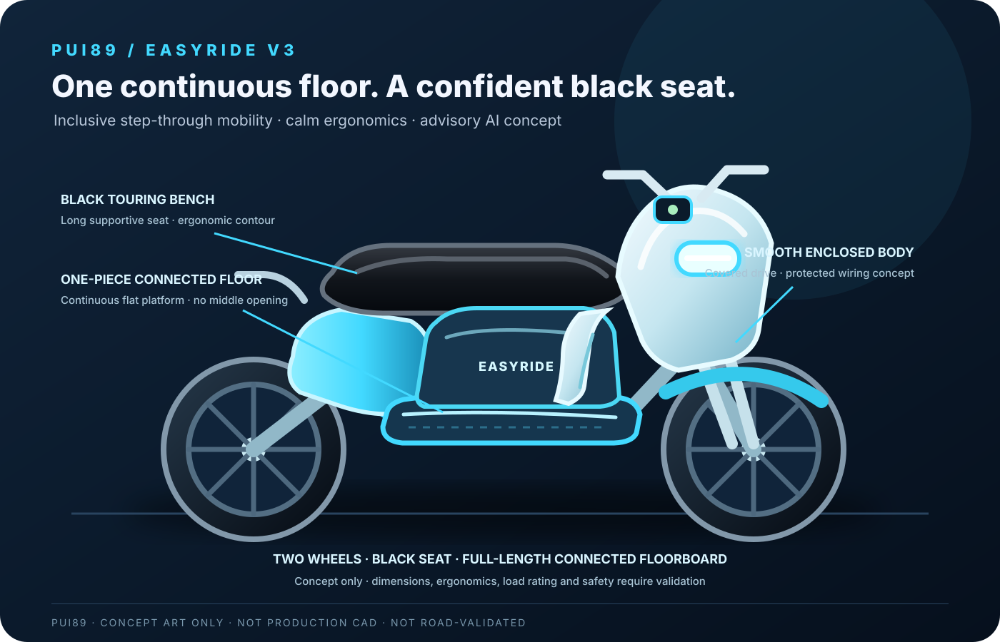

# PUI89 AI Robot Motorcycle — EasyRide Inclusive Concept

## PUI89 — Intelligent Systems. Verifiable Decisions. Safer Outcomes.

PUI89 develops intelligent software and next-generation robotic systems for practical challenges across agriculture, emergency response, multimodal inspection, home environments and mobility. Our engineering approach integrates perception, contextual reasoning, decision intelligence, safety engineering and evidence-led validation.

### Engineering capabilities

- **Perception and sensing:** visual, spatial and multimodal information processing.
- **Context and reasoning:** world-state representation, uncertainty handling and evidence alignment.
- **Decision intelligence:** structured recommendations, action proposals and human approval boundaries.
- **Safety engineering:** risk-aware operating limits, safe-state logic and failure reporting.
- **Verification and assurance:** reproducible tests, benchmark records, provenance and traceable engineering evidence.

### Technology governance

PUI89 selects and integrates technologies according to capability, provenance, security, licence obligations, maintainability, interoperability and operational suitability. Product claims are grounded in documented implementation and validation rather than a list of underlying components. Required third-party notices and attributions remain in the appropriate technical and legal records.

**Development principle:** distinguish implemented capabilities, tested software behaviour, simulation results, proposed designs and independently validated real-world performance. A concept or passing software test is not represented as a commercially validated physical product.

## Commercial readiness progress

**28% — evidence-based commercial-readiness estimate**  
**Target: 100% = ready for an appropriately scoped commercial release or formal commercial procurement submission.** This is not a code-completion percentage, a sales forecast, or a claim of product certification. Scores are provisional and based on the evidence currently documented in this repository; they must be revised when new evidence is verified.

The repository contains an early concept and engineering foundation, rider-centred requirements and software research scaffolding. No functioning motorcycle, real vehicle integration, validated perception, rider testing or road certification is established.

| Readiness gate | Weight | Evidence credit |
|---|---:|---:|
| Product purpose & requirements | 10 | 8 |
| Architecture & engineering design | 10 | 8 |
| Working software baseline | 15 | 4 |
| Reproducible tests & evaluation | 15 | 3 |
| Integrated product prototype | 15 | 0 |
| Safety, reliability & real-world validation | 15 | 1 |
| Licensing, IP & regulatory readiness | 10 | 3 |
| Commercial release package & support | 10 | 1 |
| **Total** | **100** | **28** |

**What 100% requires:** a defined product and acceptance criteria; integrated release candidate; reproducible performance and reliability evidence; appropriate safety and real-world validation; verified rights/licences and applicable regulatory conformity; manufacturing/deployment, pricing, warranty, maintenance, user documentation and support arrangements. A score of 100% is awarded only after all applicable release gates are evidenced and reviewed. Partner or research discussions may happen earlier, but must be labelled as development-stage collaboration—not a ready-to-sell product.

**Next commercial-readiness gate:** close the missing evidence above, beginning with project-specific working-product validation and safety evidence. Never count a planned feature, concept image, tool inventory, synthetic-only result or unrun test as a completed gate.

_Last readiness review: 7 November 2026. This estimate can rise or fall as evidence changes._

## Project website QR codes

<table><tr><td align="center"><strong>English website</strong>  <a href="https://pui89.github.io/ai-robot-motorcycle.html">Open English website</a></td><td align="center"><strong>เว็บไซต์ภาษาไทย</strong>  <a href="https://pui89.github.io/ai-robot-motorcycle-th.html">เปิดเว็บไซต์ภาษาไทย</a></td></tr></table>

  

**Design direction:** friendly, simple, softly rounded and approachable — with a low step-through frame, upright posture, supportive seat and easy-to-understand controls.

**Project type:** AI-enabled motorcycle research concept; software-first and simulation-first.  
**Status:** Early-stage concept and engineering foundation — not a built, tested, or road-certified vehicle.

## Mission

Develop a welcoming motorcycle concept that is easier to mount, comfortable to sit on and manageable at low speed for a broad range of adult riders. AI assistance is limited to hazard awareness, road-condition context, vehicle-health monitoring and clear advisory support. The rider remains responsible for vehicle control. No autonomous riding or physical actuation is enabled.

## EasyRide V3 visual design

- **Seat:** black, long touring-style bench with supportive contour; final passenger ergonomics require user trials.
- **Floor:** one continuous, broad, flat, non-slip platform through the central step-through area, with no middle cut-out or open gap. Structural integration and foot clearance require engineering validation.
- The updated V3 concept replaces the earlier open-centre illustration and is used on both language versions of the project page and both PUI89 homepages.

## EasyRide visual design

- Rounded, friendly body panels with a compact, clean silhouette.
- Low, open step-through space and a broad, non-slip floorboard designed to make mounting in skirts or dresses easier.
- Smooth leg-area panels and a fully enclosed chain/belt design target to reduce clothing snag points; actual clothing clearance and safety require user testing.
- Upright riding posture, supportive seat and relaxed handlebar reach.
- Clear headlamp and simple high-contrast display.
- Low-centre battery packaging as a design study, not a verified layout.
- Calm Deep Navy, pearl white, soft cyan and mint accent palette.

See the [inclusive design brief](docs/EASYRIDE_INCLUSIVE_DESIGN.md) and [concept SVG](docs/CONNECTED_FLOOR_BLACK_SEAT_V3.svg).

## PUI89 engineering rules

- **Local-first:** external services and datasets require prior technical, licensing and security review.
- **Simulation first:** no commands to physical vehicles, motors, brakes, steering or batteries.
- **Safety before features:** fail-safe behavior, human override, uncertainty reporting and hazard analysis are mandatory.
- **Evidence before claims:** distinguish implemented, simulated, proposed and independently validated capabilities.
- **Shared AI Core:** reuse PUI89 contracts and safety/evidence components; avoid duplicate core systems.
- **Security by default:** least privilege, dependency and secret checks, protected branches and review before release.
- **No unsupported performance or road-safety claims.**

## Inclusive rider-first requirements

- Make mounting and dismounting easier with a low, wide step-through opening, including for riders wearing skirts or dresses.
- Provide a broad, flat, non-slip footboard, smooth snag-resistant side covers and an enclosed chain/belt layout; test hem clearance and safe foot placement.
- Do not claim all clothing is safe: loose or long fabric can still catch in wheels or moving parts, so protective riding gear and clothing guidance remain important.
- Provide upright posture, supportive seating, relaxed reach and adjustable contact points.
- Evaluate low-centre-of-gravity packaging without sacrificing strength or braking capability.
- Design readable displays, tactile controls, clear lighting and adjustable advisory alerts.
- Validate fit with diverse adult riders; never claim one size fits everyone.
- Treat ABS, traction control, hill-hold, walk-assist and reverse-assist as proposed features requiring qualified engineering and validation.

## Initial AI capability areas

1. Rider-assistance concept: hazard detection and clear warnings.
2. Vehicle health: monitored-state model for battery, electrical, thermal and component anomalies.
3. Environmental awareness: road surface, weather, visibility and nearby-object observations where lawful datasets or simulation are available.
4. Safety supervisor: confidence thresholds, stale-data detection, conflict handling, safe degradation and human override.
5. Evidence and evaluation: scenario-based tests, false-positive/false-negative tracking, latency measurement and reproducible reports.

## Agentic AI, VLM and VLA research direction

The roadmap explores three complementary areas for rider-first assistance. These are **planned research directions**, not claims that the models or capabilities are already implemented.

### 1. Agentic AI — bounded rider-support agents
- Explore agents for organizing observations, checking data freshness, summarizing road/weather context, tracking vehicle-health evidence and preparing understandable rider advisories.
- Require explicit task boundaries, provenance, confidence, uncertainty reporting and human approval for consequential outputs.
- Keep deterministic safety gates independent of agent reasoning. Agents cannot control the motorcycle or override the rider.

### 2. Vision-Language Models (VLMs) — visual scene understanding
- Research image-and-text understanding for road-surface conditions, obstacles, signs, visibility, nearby objects and vehicle inspection observations.
- Evaluate lighting, rain, occlusion, camera placement, motion blur, domain shift, false alarms and missed hazards using licensed datasets or synthetic scenarios.
- Treat every output as an uncertain observation with source and timestamp; use clear advisory wording and preserve rider attention.

### 3. Vision-Language-Action (VLA) — mock action proposals only
- Study VLA methods in simulation to translate visual/language context into structured **non-executing** proposals, such as “increase following-distance awareness” or “ask the rider to inspect a warning”.
- Store proposals as typed **ActionProposal** records with preconditions, confidence, expected effects, risk and evidence references.
- Do not generate or execute steering, throttle, braking, acceleration, gear, motor, battery or other physical-control commands. The rider remains in control at all times.
- Any future hardware study requires a separate safety case, qualified engineering, regulatory review and validated rider testing.

**Research sequence:** shared AI Core contracts → deterministic rider-advisory baseline → synthetic/simulation scenarios → VLM evaluation → bounded agent orchestration → mock VLA proposals → robustness, usability and safety evaluation. No new model weights, packages, paid APIs, subscriptions or cloud compute are required or authorized by this roadmap.

## Development stages

1. Define requirements, hazards, operating boundaries and shared AI Core interfaces.
2. Build software-only data contracts and deterministic baseline logic.
3. Create synthetic/simulation scenarios; do not connect to a real motorcycle.
4. Add evaluation, robustness, security and regression tests.
5. Consider hardware only after documented safety reviews, legal review and qualified engineering validation.

## Weight and validation boundary

An early feasibility study may explore a 95–110 kg vehicle-mass target, excluding optional accessories. This is an unvalidated research target, not a final specification. Rider fit, structural strength, braking, stability, load capacity and regulatory requirements take priority over weight reduction.

Water resistance, fire resistance, battery safety, braking performance and durability are requirements to investigate and test — they are not verified capabilities.

## Current truth

This repository is an initial software and research scaffold. It does not contain a functioning motorcycle, validated perception model, real-time vehicle integration or certified safety system. All outputs are advisory prototypes until independently validated.

## Repository map

- `docs/PROJECT_PLAN.md` — scope, architecture and staged roadmap.
- `docs/EASYRIDE_INCLUSIVE_DESIGN.md` — rider ergonomics, inclusive design, durability and validation requirements.
- `docs/CONNECTED_FLOOR_BLACK_SEAT_V3.svg` — original friendly EasyRide concept illustration; not production CAD.
- `docs/SAFETY_CASE.md` — hazards, safeguards and validation boundaries.
- `SECURITY.md` — vulnerability reporting and security policy.
- `tests/` — software-only tests.
- `.github/workflows/quality.yml` — dependency-light automated checks.

## PUI89 portfolio links

- **English project page:** [PUI89 EasyRide AI Motorcycle](https://pui89.github.io/ai-robot-motorcycle.html)
- **Thai project page:** [PUI89 EasyRide AI Motorcycle — ภาษาไทย](https://pui89.github.io/ai-robot-motorcycle-th.html)
- **PUI89 main portfolio:** [https://pui89.github.io/](https://pui89.github.io/)
- **Website source repository:** [Pui89/Pui89.github.io](https://github.com/Pui89/Pui89.github.io)
- **Car companion project:** [PUI89 AI Robot Car](https://github.com/Pui89/ai-robot-car)

## License

See the repository's [LICENSE](LICENSE) file for the applicable permissions and conditions.

## Hugging Face vision models — opt-in local integration

This repository now includes real Hugging Face checkpoint adapters in [`pui89_models/hf_vision.py`](pui89_models/hf_vision.py), with project-specific usage boundaries in [`docs/HUGGING_FACE_MODEL_INTEGRATION.md`](docs/HUGGING_FACE_MODEL_INTEGRATION.md).

- **OWLv2:** `google/owlv2-base-patch16-ensemble` for text-conditioned object proposals.
- **Intel DPT-Hybrid:** `Intel/dpt-hybrid-midas` for relative scene depth where appropriate; not calibrated distance or physical depth.
- **local-first default:** no packages or model weights are installed/downloaded automatically; CPU-only inference, local cache only by default, no hosted inference API or cloud GPU.
- **Evidence status:** adapter code is added; model inference and project-specific accuracy are NOT YET TESTED. Outputs remain uncertain observations for human review, never actuator commands.

## PUI89 efficient engineering profile

This project follows the shared [PUI89 Efficient Engineering Standard](https://github.com/Pui89/Pui89.github.io/blob/main/PUI89_EFFICIENT_ENGINEERING_STANDARD.md). The standard is proposed in portfolio PR #152 and becomes the canonical reference after merge.

**Project focus:** Prioritise low-power monitoring, advisory latency, resource-bounded perception, battery/thermal health and fail-safe degradation. Do not optimise by weakening rider alerts, deterministic safety gates or human control.

Track relevant RAM, CPU/GPU, latency, storage and network measurements using documented workloads and comparable environments. Record power (W/Wh), battery runtime and temperature only when suitable physical instruments and hardware are available. External services, datasets and model downloads require explicit review before adoption. Efficiency changes must preserve accuracy, safety, evidence integrity, privacy and security. Unmeasured physical performance must be labelled **not measured**.
