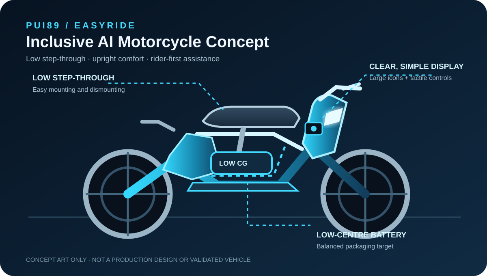

# PUI89 AI Robot Motorcycle — EasyRide Inclusive Concept

  

**Design direction:** friendly, simple, softly rounded and approachable — with a low step-through frame, upright posture, supportive seat and easy-to-understand controls.

**Project type:** AI-enabled motorcycle research concept; software-first and simulation-first.  
**Status:** Early-stage concept and engineering foundation — not a built, tested, or road-certified vehicle.

## Mission

Develop a welcoming motorcycle concept that is easier to mount, comfortable to sit on and manageable at low speed for a broad range of adult riders. AI assistance is limited to hazard awareness, road-condition context, vehicle-health monitoring and clear advisory support. The rider remains responsible for vehicle control. No autonomous riding or physical actuation is enabled.

## EasyRide visual design

- Rounded, friendly body panels with a compact, clean silhouette.
- Low, open step-through space and a broad, non-slip floorboard designed to make mounting in skirts or dresses easier.
- Smooth leg-area panels and a fully enclosed chain/belt design target to reduce clothing snag points; actual clothing clearance and safety require user testing.
- Upright riding posture, supportive seat and relaxed handlebar reach.
- Clear headlamp and simple high-contrast display.
- Low-centre battery packaging as a design study, not a verified layout.
- Calm Deep Navy, pearl white, soft cyan and mint accent palette.

See the [inclusive design brief](docs/EASYRIDE_INCLUSIVE_DESIGN.md) and [concept SVG](docs/EASYRIDE_CONCEPT.svg).

## PUI89 engineering rules

- **Strict zero-cost:** no paid APIs, subscriptions, cloud GPU, paid datasets or metered services.
- **Simulation first:** no commands to physical vehicles, motors, brakes, steering or batteries.
- **Safety before features:** fail-safe behavior, human override, uncertainty reporting and hazard analysis are mandatory.
- **Evidence before claims:** distinguish implemented, simulated, proposed and independently validated capabilities.
- **Shared AI Core:** reuse PUI89 contracts and safety/evidence components; avoid duplicate core systems.
- **Security by default:** least privilege, dependency and secret checks, protected branches and review before release.
- **No unsupported performance or road-safety claims.**

## Inclusive rider-first requirements

- Make mounting and dismounting easier with a low, wide step-through opening, including for riders wearing skirts or dresses.
- Provide a broad, flat, non-slip footboard, smooth snag-resistant side covers and an enclosed chain/belt layout; test hem clearance and safe foot placement.
- Do not claim all clothing is safe: loose or long fabric can still catch in wheels or moving parts, so protective riding gear and clothing guidance remain important.
- Provide upright posture, supportive seating, relaxed reach and adjustable contact points.
- Evaluate low-centre-of-gravity packaging without sacrificing strength or braking capability.
- Design readable displays, tactile controls, clear lighting and adjustable advisory alerts.
- Validate fit with diverse adult riders; never claim one size fits everyone.
- Treat ABS, traction control, hill-hold, walk-assist and reverse-assist as proposed features requiring qualified engineering and validation.

## Initial AI capability areas

1. Rider-assistance concept: hazard detection and clear warnings.
2. Vehicle health: monitored-state model for battery, electrical, thermal and component anomalies.
3. Environmental awareness: road surface, weather, visibility and nearby-object observations where lawful datasets or simulation are available.
4. Safety supervisor: confidence thresholds, stale-data detection, conflict handling, safe degradation and human override.
5. Evidence and evaluation: scenario-based tests, false-positive/false-negative tracking, latency measurement and reproducible reports.

## Agentic AI, VLM and VLA research direction

The roadmap explores three complementary areas for rider-first assistance. These are **planned research directions**, not claims that the models or capabilities are already implemented.

### 1. Agentic AI — bounded rider-support agents
- Explore agents for organizing observations, checking data freshness, summarizing road/weather context, tracking vehicle-health evidence and preparing understandable rider advisories.
- Require explicit task boundaries, provenance, confidence, uncertainty reporting and human approval for consequential outputs.
- Keep deterministic safety gates independent of agent reasoning. Agents cannot control the motorcycle or override the rider.

### 2. Vision-Language Models (VLMs) — visual scene understanding
- Research image-and-text understanding for road-surface conditions, obstacles, signs, visibility, nearby objects and vehicle inspection observations.
- Evaluate lighting, rain, occlusion, camera placement, motion blur, domain shift, false alarms and missed hazards using licensed datasets or synthetic scenarios.
- Treat every output as an uncertain observation with source and timestamp; use clear advisory wording and preserve rider attention.

### 3. Vision-Language-Action (VLA) — mock action proposals only
- Study VLA methods in simulation to translate visual/language context into structured **non-executing** proposals, such as “increase following-distance awareness” or “ask the rider to inspect a warning”.
- Store proposals as typed **ActionProposal** records with preconditions, confidence, expected effects, risk and evidence references.
- Do not generate or execute steering, throttle, braking, acceleration, gear, motor, battery or other physical-control commands. The rider remains in control at all times.
- Any future hardware study requires a separate safety case, qualified engineering, regulatory review and validated rider testing.

**Research sequence:** shared AI Core contracts → deterministic rider-advisory baseline → synthetic/simulation scenarios → VLM evaluation → bounded agent orchestration → mock VLA proposals → robustness, usability and safety evaluation. No new model weights, packages, paid APIs, subscriptions or cloud compute are required or authorized by this roadmap.

## Development stages

1. Define requirements, hazards, operating boundaries and shared AI Core interfaces.
2. Build software-only data contracts and deterministic baseline logic.
3. Create synthetic/simulation scenarios; do not connect to a real motorcycle.
4. Add evaluation, robustness, security and regression tests.
5. Consider hardware only after documented safety reviews, legal review and qualified engineering validation.

## Weight and validation boundary

An early feasibility study may explore a 95–110 kg vehicle-mass target, excluding optional accessories. This is an unvalidated research target, not a final specification. Rider fit, structural strength, braking, stability, load capacity and regulatory requirements take priority over weight reduction.

Water resistance, fire resistance, battery safety, braking performance and durability are requirements to investigate and test — they are not verified capabilities.

## Current truth

This repository is an initial software and research scaffold. It does not contain a functioning motorcycle, validated perception model, real-time vehicle integration or certified safety system. All outputs are advisory prototypes until independently validated.

## Repository map

- `docs/PROJECT_PLAN.md` — scope, architecture and staged roadmap.
- `docs/EASYRIDE_INCLUSIVE_DESIGN.md` — rider ergonomics, inclusive design, durability and validation requirements.
- `docs/EASYRIDE_CONCEPT.svg` — original friendly EasyRide concept illustration; not production CAD.
- `docs/SAFETY_CASE.md` — hazards, safeguards and validation boundaries.
- `SECURITY.md` — vulnerability reporting and security policy.
- `tests/` — software-only tests.
- `.github/workflows/quality.yml` — dependency-light automated checks.

## PUI89 portfolio links

- **English project page:** [PUI89 EasyRide AI Motorcycle](https://pui89.github.io/ai-robot-motorcycle.html)
- **Thai project page:** [PUI89 EasyRide AI Motorcycle — ภาษาไทย](https://pui89.github.io/ai-robot-motorcycle-th.html)
- **PUI89 main portfolio:** [https://pui89.github.io/](https://pui89.github.io/)
- **Website source repository:** [Pui89/Pui89.github.io](https://github.com/Pui89/Pui89.github.io)
- **Car companion project:** [PUI89 AI Robot Car](https://github.com/Pui89/ai-robot-car)

## Hugging Face model candidates — Non-Chinese origin only

**PUI89 mandatory rule:** use only models with verified non-Chinese developer and checkpoint provenance. Unknown or unclear origin means exclude. This section is a candidate list only; no weights have been downloaded, installed, or evaluated.

| Candidate checkpoint | Research role | Status |
|---|---|---|
| [google/siglip2-base-patch16-224](https://huggingface.co/google/siglip2-base-patch16-224) | Road-scene image/text similarity research | CANDIDATE — review required |
| [facebook/dinov2-base](https://huggingface.co/facebook/dinov2-base) | Visual feature extraction for scene and change comparison | CANDIDATE — review required |
| [microsoft/Florence-2-base](https://huggingface.co/microsoft/Florence-2-base) | Offline scene description, OCR and candidate object localization | CANDIDATE — review required |
| [openai/whisper-tiny](https://huggingface.co/openai/whisper-tiny) | Optional multilingual voice-interface transcription | CANDIDATE — review required |

Research/advisory perception only. Not a motorcycle safety system and never controls steering, throttle, brakes, motor, battery or rider functions. Rider remains in control.

**Adoption gates:** verify the exact checkpoint's developer, origin, immutable revision, model-card and file licence, training-data disclosures, code/dependency security, file format, hardware fit and total cost before any download or execution. No paid APIs, hosted inference, cloud GPUs, automatic downloads or direct physical control. Florence-2 requires extra source review because its documented loader uses trust_remote_code=True. All models remain research-only until independently evaluated and approved.

**Shared policy:** [PUI89 Hugging Face Model Policy](https://github.com/Pui89/Pui89.github.io/blob/main/docs/PUI89_HUGGINGFACE_MODEL_POLICY.md).

## License

See the repository's [LICENSE](LICENSE) file for the applicable permissions and conditions.

## Robotics foundation model candidates — Non-Chinese origin only

### Shortlisted candidate: SmolVLA

- Checkpoint: [`lerobot/smolvla_base`](https://huggingface.co/lerobot/smolvla_base)
- Publisher/developer: Hugging Face / LeRobot
- Model-card licence: Apache-2.0
- Size: 450 million parameters
- Type: Vision-Language-Action (VLA); consumes camera images, robot state and an optional language instruction, and predicts continuous action sequences.
- Status: **CANDIDATE ONLY — not downloaded, installed, tested or approved for physical deployment.**

The model card describes SmolVLA as a compact VLA designed for robot manipulation research. It still requires robot-specific demonstrations, fine-tuning and evaluation; the published training guidance uses a GPU. Its 450M parameter count does not guarantee it will run acceptably on this project's available hardware or without cost.

### Project fit and limits

- **Coconut Harvest AI:** possible simulation-only research for a robot arm's bounded grasp/reach/cut-preparation proposal. It is not validated for harvesting, outdoor conditions, people/animals nearby, coconut mass, cutting forces or the 0–30 m operating concept. Cutting and release must remain independently guarded and human-supervised.
- **Flood Rescue AI:** not suitable as boat navigation, water-current control, rescue approach or propulsion policy. Consider only if a separate manipulator is designed, and then only in a controlled simulator with bounded proposals.
- **Sentinel Multimodal Screening AI:** not a substance-identification, search, enforcement or autonomous screening model. Consider only for a future non-consequential manipulator research task, if one is defined; otherwise do not integrate.
- **AI HOME:** not a general indoor mobile-navigation or hazard-response policy. Do not use for driving wheels, stairs, doors, appliance control or emergency response. A future arm/gripper task would require separate robot-specific validation.
- **AI NOMAD:** **not recommended for quadruped locomotion, gait, balance, foothold selection or outdoor navigation.** SmolVLA's manipulation focus does not establish dog-like mobility capability.
- **AI Car:** **not suitable for vehicle control.** No steering, throttle, braking, gear, propulsion or road-decision authority.
- **AI Motorcycle / EasyRide:** **not suitable for motorcycle control.** No steering, throttle, braking, balance, motor or rider-safety authority.

### Additional candidates not approved

- **OpenVLA 7B** ([model card](https://huggingface.co/openvla/openvla-7b)): research reference only, **HOLD — LICENCE REVIEW REQUIRED**. Although the Hugging Face card labels the checkpoint MIT, the upstream OpenVLA repository warns that the pretrained weights may inherit the Llama 2 Community License. The 7B model also has substantial compute needs and documents remote custom code. Do not adopt, download or commercially use until the exact weight terms and code are reconciled.

### Robotics safety rule

A VLA predicts actions; it is not a safety controller. In PUI89 it may only produce a bounded, logged **ActionProposal** for a simulator or an independently reviewed offline experiment. It must never issue actuator commands. Require typed observations, robot-specific coordinate/action mapping, joint and workspace limits, collision checks, speed/force limits, emergency stop, watchdog, deterministic safety interlocks, human approval, and a verified safe fallback outside the model. No physical robot tests are authorized by this documentation.

