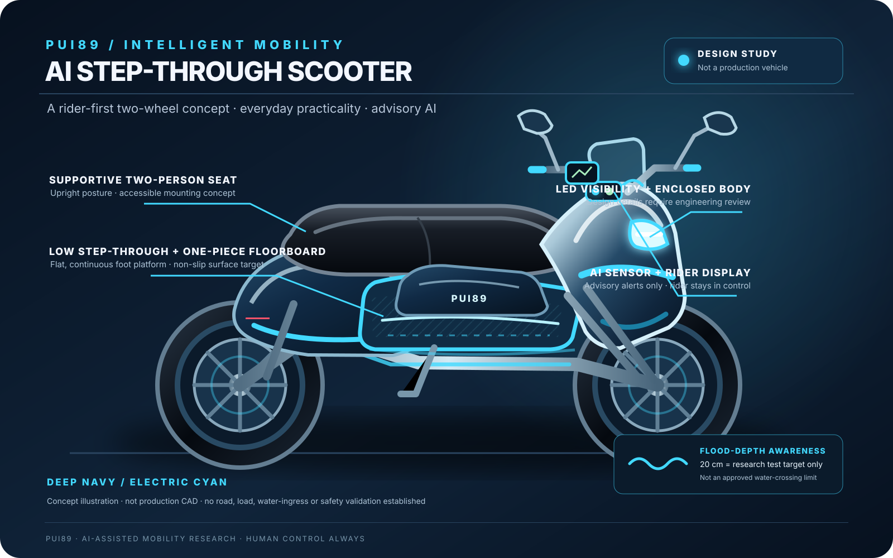

# PUI89 AI Step-Through Scooter

**A rider-first, two-wheel step-through scooter concept with advisory AI awareness.**

[English project page](https://pui89.github.io/ai-robot-motorcycle.html) · [ภาษาไทย](https://pui89.github.io/ai-robot-motorcycle-th.html) · [PUI89 portfolio](https://pui89.github.io/)

*Concept artwork only. It is not a functioning scooter or evidence of road testing.*

## What this product is

PUI89 AI Step-Through Scooter is a **practical two-wheel step-through mobility concept**. Easy mounting, a usable step-through floorboard and rider-first controls define the product direction. AI provides information and warnings; the rider remains responsible for riding.

**ผู้ใช้งาน:** ผู้เดินทางประจำวัน ผู้ใช้รถจักรยานยนต์ในเมือง และผู้ที่ต้องการรถแบบ Step-Through ที่ขึ้นลงสะดวก  
**ประโยชน์หลัก:** เพิ่มข้อมูลประกอบการรับรู้สภาพถนนและสุขภาพรถ โดยผู้ขับขี่ยังคงควบคุมรถเองทั้งหมด

## Product-specific functions

- Near-field awareness of vehicles, pedestrians, animals, obstacles and road context.
- Weather, visibility, road-surface and water-on-road/flood-risk warnings.
- Read-only battery, motor and vehicle-health information where supported by verified interfaces.
- Concise rider alerts and route-context assistance.
- Rider-focused ergonomics and interaction that minimise distraction.

## Rider-control boundary

AI must **not** command steering, throttle or braking. Flood-risk alerts are advisory and do not establish water-crossing ability, waterproofing or safe wading depth. The rider retains full control.

## What is not established

- No functioning scooter, vehicle integration, rider trial or road validation is established.
- No collision-prevention performance, flood-crossing ability, stability result or roadworthiness certification is claimed.
- No autonomous riding or physical actuation is in scope.

## Current development status

**Specified — rider-first two-wheel step-through requirements are documented.** No physical scooter, rider trials or road certification is established.

**Next evidence gate:** define rider use cases, vehicle architecture, sensor placement, operating limits, hazard analysis and measurable acceptance criteria before a prototype is selected or built.

## Product documentation

- [Step-Through Scooter concept illustration](docs/PUI89_AI_STEP_THROUGH_SCOOTER_CONCEPT.svg)
- [PUI89 product page](https://pui89.github.io/ai-robot-motorcycle.html)

## Shared PUI89 engineering

Cross-product architecture, evidence contracts, safety, privacy, security, recovery, device interaction and localization requirements are maintained in the [PUI89 Shared AI Core](https://github.com/Pui89/PUI89-Shared-AI-Core). Scooter-specific rider controls, mounting, vibration, weather exposure and road safety require separate validation.

Current maturity labels follow the [PUI89 Portfolio Alignment Register](https://github.com/Pui89/Pui89.github.io/blob/main/docs/PUI89_PORTFOLIO_ALIGNMENT_REGISTER_2026-11-18.md) and [Evidence-Based Development Maturity Standard](https://github.com/Pui89/Pui89.github.io/blob/main/docs/PUI89_DEVELOPMENT_STAGE_STANDARD.md).
