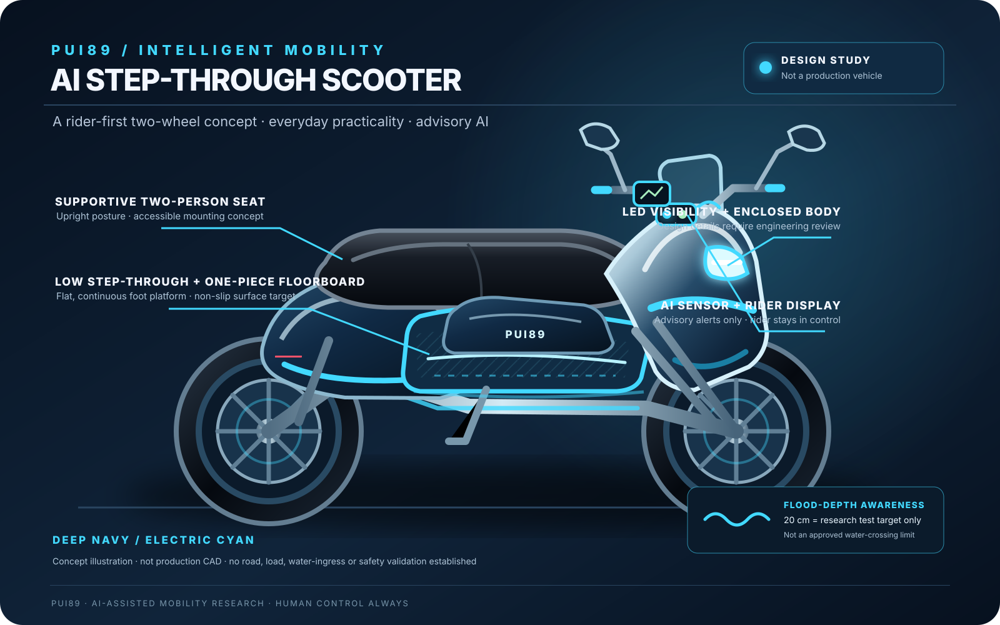

# PUI89 AI Step-Through Scooter

**แนวคิดสกู๊ตเตอร์แบบ Step-Through สองล้อที่ให้ความสำคัญกับผู้ขับขี่ พร้อม AI สำหรับการรับรู้และแจ้งเตือนเชิงคำแนะนำ**

[English](README.md) · [ภาษาไทย](README.th.md) · [เว็บไซต์ภาษาอังกฤษ](https://pui89.github.io/ai-robot-motorcycle.html) · [เว็บไซต์ภาษาไทย](https://pui89.github.io/ai-robot-motorcycle-th.html) · [PUI89 Portfolio](https://pui89.github.io/)

*ภาพแนวคิดเท่านั้น ไม่ใช่สกู๊ตเตอร์ที่ใช้งานได้จริงหรือหลักฐานการทดสอบบนถนน*

## 1. ผลิตภัณฑ์นี้คืออะไร

PUI89 AI Step-Through Scooter เป็นแนวคิดยานพาหนะสองล้อแบบ Step-Through ที่เน้นการขึ้นลงสะดวก พื้นวางเท้าใช้งานได้จริง และการควบคุมที่ให้ผู้ขับขี่เป็นศูนย์กลาง AI ทำหน้าที่ให้ข้อมูลและคำเตือน ผู้ขับขี่ยังคงรับผิดชอบการขับขี่ทั้งหมด

## 2. ภารกิจและขอบเขตหน้าที่

มุ่งสนับสนุนการเดินทางประจำวันและเพิ่มการรับรู้สภาพถนนกับสุขภาพรถ โดยไม่เปลี่ยนบทบาทผู้ขับขี่หรือควบคุมรถแทนมนุษย์

## 3. ผู้ใช้งานและคุณค่าที่มุ่งส่งมอบ

ผู้เดินทางประจำวัน ผู้ใช้รถจักรยานยนต์ในเมือง และผู้ที่ต้องการรถแบบ Step-Through ที่ขึ้นลงสะดวก โดยเน้นการใช้งานจริง การยศาสตร์ และคำเตือนที่ไม่รบกวนสมาธิ

## 4. ความสามารถเฉพาะผลิตภัณฑ์

- รับรู้ยานพาหนะ คนเดินเท้า สัตว์ สิ่งกีดขวาง และบริบทถนนระยะใกล้
- แจ้งเตือนสภาพอากาศ ทัศนวิสัย พื้นผิวถนน และความเสี่ยงน้ำบนถนน/น้ำท่วม
- อ่านข้อมูลแบตเตอรี่ มอเตอร์ และสุขภาพรถแบบ Read-only เมื่อมีอินเทอร์เฟซที่ตรวจสอบแล้ว
- แจ้งเตือนผู้ขับขี่อย่างกระชับและให้ข้อมูลบริบทเส้นทาง
- ออกแบบการโต้ตอบโดยลดการเบี่ยงเบนความสนใจ

## 5. AI และสถาปัตยกรรมความฉลาด

ความสามารถที่อาจใช้ ได้แก่ Object Detection, Object Tracking, Sensor Fusion, Anomaly Detection, Predictive Models และ Image Segmentation สำหรับการรับรู้บริบทถนน เป็นแนวทางการจัดสรรความสามารถที่ต้องทดสอบ ไม่ใช่หลักฐานว่ามีการติดตั้งหรือผ่านการตรวจสอบแล้ว

## 6. ฮาร์ดแวร์และเซนเซอร์

เป็นแนวคิดสกู๊ตเตอร์สองล้อแบบ Step-Through ยังไม่มีแพลตฟอร์มผลิตจริงที่เลือกหรือการบูรณาการยานพาหนะ รายละเอียดจำนวนผู้โดยสาร น้ำหนักบรรทุก มวลรวม ขนาด ระยะฐานล้อ ความสูงเบาะ และระยะใต้ท้องรถยังเป็น TBD

## 7. ความปลอดภัย ความเป็นส่วนตัว และความมั่นคงปลอดภัย

- AI ให้คำแนะนำเท่านั้น ผู้ขับขี่ควบคุมแฮนด์/พวงมาลัย คันเร่ง และเบรกทั้งหมด
- ไม่มีการสั่งเลี้ยว เร่ง หรือเบรกอัตโนมัติ
- คำเตือนน้ำท่วมไม่ใช่หลักฐานว่าสามารถขับลุยน้ำได้หรือมีระดับกันน้ำ
- การแจ้งเตือนที่จำเป็นควรทำงานในเครื่องได้โดยไม่ต้องใช้อินเทอร์เน็ต
- ข้อมูลตำแหน่ง ภาพ เสียง และข้อมูลรถต้องไม่ถูกส่งออกโดยไม่ได้รับอนุญาต

## 8. สิ่งที่ยังไม่มีหลักฐานยืนยัน

ยังไม่มีสกู๊ตเตอร์ที่ใช้งานได้ การบูรณาการกับรถ การทดลองขับ การทดสอบถนน ผลการป้องกันการชน ความสามารถลุยน้ำ ความมั่นคงในการทรงตัว หรือการรับรองความปลอดภัยบนถนน ตัวเลขน้ำหนักรวม 190 กก. ที่เคยกล่าวถึงยังไม่ได้รับการยืนยันและไม่ใช่พิกัดบรรทุก ระดับน้ำ 20 ซม. เป็นเป้าหมายการทดสอบในอนาคตที่ยังไม่ผ่านการพิสูจน์ ไม่ใช่ความสามารถลุยน้ำ

## 9. สถานะการพัฒนาและหลักฐาน

**Specified — มีการจัดทำข้อกำหนดแนวคิดสกู๊ตเตอร์สองล้อแบบ Step-Through ที่ให้ผู้ขับขี่เป็นศูนย์กลางแล้ว** ยังไม่มีสกู๊ตเตอร์จริง การทดลองขับ หรือการรับรองบนถนน

## 10. ขั้นตอนพิสูจน์ผลถัดไป

กำหนดกรณีใช้งานของผู้ขับขี่ สถาปัตยกรรมยานพาหนะ ตำแหน่งเซนเซอร์ ขอบเขตการทำงาน การวิเคราะห์อันตราย และเกณฑ์ยอมรับที่วัดผลได้ก่อนเลือกหรือสร้างต้นแบบ

## 11. การเชื่อมต่อกับ Shared AI Core

ใช้สถาปัตยกรรมร่วม สัญญาข้อมูล หลักฐาน ความปลอดภัย ความเป็นส่วนตัว การกู้คืน และการแจ้งเตือนจาก [PUI89 Shared AI Core](https://github.com/Pui89/PUI89-Shared-AI-Core) ส่วนการควบคุมผู้ขับขี่ การขึ้นลง แรงสั่นสะเทือน สภาพอากาศ และความปลอดภัยบนถนนต้องตรวจสอบเฉพาะผลิตภัณฑ์

## 12. เอกสารและลิงก์โครงการ

- [ภาพแนวคิด Step-Through Scooter](docs/PUI89_AI_STEP_THROUGH_SCOOTER_CONCEPT.svg)
- [เว็บไซต์ภาษาอังกฤษ](https://pui89.github.io/ai-robot-motorcycle.html)
- [เว็บไซต์ภาษาไทย](https://pui89.github.io/ai-robot-motorcycle-th.html)
- [Repository](https://github.com/Pui89/AI-Step-Through-Scooter)

PUI89 AI Step-Through Scooter เป็นผลิตภัณฑ์ Mobility แยกจาก AI Global SUV และไม่มีการควบคุมการขับขี่อัตโนมัติ
