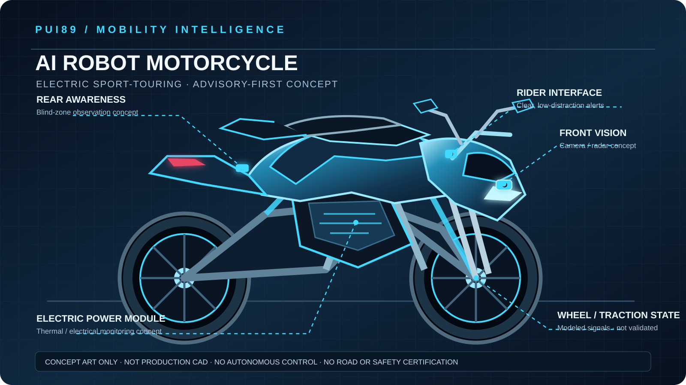

# PUI89 AI Robot Motorcycle — Design Concept

**Design direction:** electric sport-touring motorcycle with a rider-centred AI assistance layer.  
**Visual identity:** Deep Navy, graphite structure, Electric Cyan data accents, restrained luminous details.  
**Maturity:** visual and software architecture concept only; not production CAD or a built vehicle.

## 1. Product intent

Explore an advanced two-wheel mobility platform where AI supports rider awareness and vehicle-state understanding without taking control away from the rider. The concept prioritizes a stable, serviceable motorcycle architecture, clear human-facing alerts, and an auditable software boundary.

## 2. Visual design features

- **Body:** compact electric sport-touring silhouette with aerodynamic front fairing and protected central power module.
- **Front sensing concept:** forward-facing camera and optional radar module represented as conceptual placements only.
- **Rear awareness concept:** rear observation module for research into blind-zone and approaching-object scenarios.
- **Rider interface:** minimal, low-distraction alert surface; no claim of a validated display or human-factors design.
- **Wheel-state research:** modeled wheel-speed and traction observations; no active traction or brake control.
- **Power module:** enclosed battery/electrical region shown as a packaging concept; no verified thermal, ingress, crash or fire protection.
- **Structure:** conventional two-wheel layout, front fork and rear swingarm represented schematically.

## 3. AI system concept

`Synthetic Observation → Input Integrity & Freshness → WorldState → Rider / Road Risk Analysis → Safety Gate → Advisory → Evidence Record`

Potential research areas:
1. Road-surface and traction-risk scenarios: rain, wet paint, gravel, mud, oil, potholes and uneven surfaces.
2. Rider-state uncertainty: lean angle, wheel slip, instability indicators and sensor disagreement.
3. Forward/rear awareness: object presence, relative movement, occlusion and visibility limitations.
4. Vehicle health: battery, electrical and thermal anomaly observations.
5. Human factors: alert priority, timing, clarity, false alarms and distraction risk.
6. Resilience: missing, stale, noisy, contradictory, spoofed and corrupted observations.

## 4. Safety boundary

- Rider retains steering, throttle, braking and all riding decisions.
- No autonomous riding, steering, throttle, brake, ignition or propulsion control.
- No connection to a physical motorcycle, ECU, CAN bus, BMS or actuator in the current phase.
- All sensor positions and components in the illustration are conceptual, not verified specifications.
- Illustrative scenario thresholds are not validated operating limits.
- No roadworthiness, collision-avoidance, waterproof/IP, fire-resistance, battery-safety or certification claim is made.

## 5. Engineering pathway

1. Freeze the software-only scope and hazard analysis.
2. Align versioned data contracts with the shared PUI89 AI Core.
3. Expand deterministic synthetic scenarios and fault injection.
4. Record false positives, missed hazards, calibration, latency and degraded-mode behavior.
5. Conduct independent motorcycle dynamics, electrical, battery, cybersecurity, human-factors and regulatory reviews before any hardware pathway.

## 6. Zero-cost and supply-chain policy

No paid APIs, subscriptions, cloud GPUs, paid datasets, metered services or unapproved dependencies. Check licences, commercial-use terms, privacy, resource requirements and billing exposure before adopting any tool or model. Prefer established non-Chinese resources consistent with the PUI89 policy.

## 7. Evidence status

| Item | Status |
|---|---|
| Visual concept | Proposed |
| Software scope and hazards | Documented |
| Physical motorcycle | Not built |
| Sensor integration | Not connected |
| AI perception performance | Not validated |
| Road testing | Not performed |
| Safety / regulatory certification | Not obtained |
